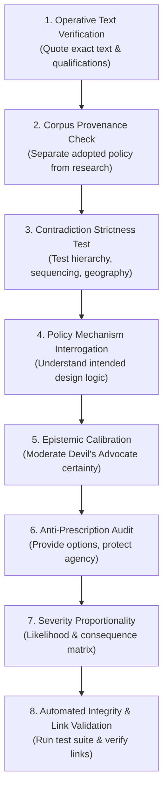

# Stage 3 Retrospective: Methodological Learnings and Quality Framework

> **Research — not adopted Fusion policy**

- **Project:** Victorian State Policy Research Programme (Stage 3 Synthesis Checkpoint).
- **Issue Reference:** Issue F-109 (`01a1452e-4aa0-7d85-8845-c062d00799b7`).
- **Author & Identity:** Policy Researcher (`d51839b3-5b90-425d-89b4-4adb15d75317`), acting on behalf of ethan.c.
- **Date & Local Time:** 17 October 2026 AEDT.
- **Purpose:** Documenting analytical errors, root causes, reviewer interventions, and corrective practices across the policy challenge review, establishing a reusable quality framework for future research.

---

## 1. Executive Summary

During Stage 3 of the Victorian State Policy Research Programme, the Policy Researcher conducted an adversarial stress-test and Devil's Advocate cross-examination of the Stage 2 inquiries (F-108 and F-113) and the wider 41-policy Victorian platform. While the critique succeeded in identifying important operational dependencies, budget trade-offs, and platform scope omissions, the initial drafts suffered from systematic methodological flaws.

Most notably, the review initially claimed to have identified "five confirmed policy contradictions" in the adopted platform, later revised to "four confirmed contradictions," before rigorous human review demonstrated that **no confirmed contradictions exist among the 41 adopted policies under the applied review criteria**.

This retrospective candidly examines the seven primary failure modes that occurred during this review, identifies their cognitive and procedural root causes, details how they were corrected, and establishes a lightweight, reusable research checklist to prevent recurrence.

---

## 2. Analysis of the Seven Failure Modes

### 2.1 Manufactured Contradictions
- **The Error:** The researcher initially labelled five policy intersections as "confirmed contradictions":
  1. Station precinct upzoning (`policy-homes-and-stations-code`) vs deliberative citizen juries (`policy-communities-set-policy`);
  2. Sovereign wealth fund capital accumulation (`policy-build-the-sovereign-fund`) vs universal basic dividend (`policy-pay-every-victorian`);
  3. Commercial parking levies (`policy-charge-the-car-parks`) vs outer-suburban park-and-ride equity (`policy-fund-the-outer-suburbs`);
  4. Bus franchise profit clawbacks (`policy-claw-back-franchise-profits`) vs network frequency expansion (`policy-stagger-the-timetables`);
  5. Windfall gains taxation (`policy-tax-the-land-windfalls`) vs transit-oriented housing development feasibility.
- **How It Was Identified:** The reviewer pointed out that none of these pairings represented mutually incompatible commitments. The analysis had overlooked institutional hierarchy, temporal sequencing, conditionality, geographic scope, and the distinction between policy goals and implementation instruments.
- **Root Cause:** Conflating *policy tensions* (competing priorities or trade-offs that require policy balance) with *logical contradictions* (commitments that genuinely cannot coexist as written). The researcher failed to quote operative text, qualifications, and exceptions before asserting incompatibility.
- **Future Practice:** A finding of "confirmed contradiction" must be strictly reserved for two actual commitments in adopted policies that cannot both be satisfied under any plausible legal, temporal, or geographic interpretation. Tensions, trade-offs, and sequencing dependencies must be categorised under their proper analytical designations.

---

### 2.2 Misunderstood Policy Mechanisms
- **The Error:** 
  - *FlexiRide Standards:* The researcher treated the high operating cost of imposing stringent 15-minute response times on demand-responsive transport (DRT) as an unintended economic failure and policy contradiction.
  - *Sovereign Fund Dividends:* The researcher treated the universal dividend as an immediate drain on capital accumulation requiring debt-financed cash payouts.
- **How It Was Identified:** The reviewer clarified that the explicit design logic of imposing high service standards on microtransit is to expose its poor unit economics ($35–$50/trip) and thereby justify transitioning funding into efficient fixed-route buses. Similarly, the reviewer noted that the sovereign fund dividend is explicitly conditional on audited net surplus after debt service, capital preservation, and infrastructure reserves.
- **Root Cause:** Imposing an external economic assumption onto a policy without first discerning its internal strategic intent and textually defined conditionality.
- **Future Practice:** Always interrogate the *policy rationale* and *stated mechanism* before evaluating outcomes. Trace the causal path intended by the authors, verify explicit conditions precedent (such as audited surplus requirements), and examine whether observed costs are an intended lever rather than an unintended defect.

---

### 2.3 Invented Policy Positions
- **The Error:** In evaluating joint tenancies under domestic violence (A07 / F16), the researcher claimed that adopted Fusion policy creates a contradiction by "preserving unsafe joint tenancies" during rent relief disbursement.
- **How It Was Identified:** The reviewer directly challenged the researcher to identify where in the adopted platform such a requirement exists: *"Identify the adopted Fusion policy that requires unsafe joint tenancies to be preserved. I haven't adopted such a policy. A safeguard needed for a proposed tenancy intervention is not a contradiction between adopted policies."*
- **Root Cause:** Projecting hypothetical operational scenarios or unstated baseline assumptions onto the political party as if they were affirmative adopted commitments.
- **Future Practice:** Never attribute a position to the party without citing the specific URL, slug, and operative text from `policies.json`. If an intervention requires an operational safeguard, frame it as an implementation design safeguard for research proposals, not an adopted policy defect.

---

### 2.4 Unsupported Certainty (Devil's Advocate Overreach)
- **The Error:** In executing the Devil's Advocate persona, the researcher asserted that cash arrears assistance produces "80%+ deadweight loss," claimed that commercial parking charges would cause "inevitable commuter exclusion," and declared that headway staggering would cause "catastrophic rail connection failure."
- **How It Was Identified:** The reviewer observed that the Devil's Advocate exercise had introduced its own unsupported certainty. The 80%+ figure conflated avoiding formal shelter entry with the total value of preventing housing instability, school disruption, and acute poverty.
- **Root Cause:** Epistemic over-enthusiasm. In attempting to provide a rigorous adversarial challenge, the researcher confused *identifying plausible downside risks* with *proving inevitable failure*, treating extreme econometric upper bounds as established facts.
- **Future Practice:** Maintain epistemic modesty. Calibrate confidence levels to empirical evidence. Present counterarguments with appropriate caveats, distinguish plausible risks from verified facts, and report the full spectrum of intervention value rather than a single narrow counterfactual metric.

---

### 2.5 Research Contamination
- **The Error:** In finding F17, the researcher asserted that adopted Fusion policy suffered from a contradiction by claiming non-cashable downstream hospital and justice savings as cashable Treasury revenue.
- **How It Was Identified:** The reviewer pointed out that no adopted policy claimed these savings as cash revenue; the error originated entirely in the Policy Researcher's own prior Stage 2 research paper (F-113, Claim A08).
- **Root Cause:** Conflating researcher-authored analytical literature reviews with adopted party platform documents. The researcher audited their own prior modeling mistakes and attributed them to the political party's corpus.
- **Future Practice:** Strictly maintain provenance boundaries. Distinguish three distinct categories:
  1. *Adopted Platform Policies* (the authorised public Sanity export in `policies.json`);
  2. *Research Proposals and Literature Reviews* (analyst-authored background papers);
  3. *Researcher Recommendations* (options presented for human consideration).
  Errors originating in research papers must be logged as *research evidence corrections*, never as *policy platform contradictions*.

---

### 2.6 Prescriptive Overreach
- **The Error:**
  - *FlexiRide:* Prescribing rigid "statutory transition triggers" requiring new legislation to convert microtransit to fixed-route buses.
  - *Family Violence:* Prescribing "mandatory, automatic lease severance" under RTA s 91V as a compulsory prerequisite for receiving rent relief.
  - *Inclusionary Zoning:* Declaring that the Homes and Stations Code "must" mandate a 20% inclusionary zoning requirement.
- **How It Was Identified:** The reviewer emphasised that:
  - Transitioning microtransit is an operational service planning matter within DTP contracts, requiring transparent unit costing and administrative decision frameworks rather than unnecessary statutory machinery.
  - Mandatory lease severance takes agency away from victim-survivors, could alert violent perpetrators, and might displace families. Interventions must be survivor-centred, confidential, and consent-based.
  - Inclusionary zoning is one political value choice among several; researchers advise on evidence and trade-offs, while humans decide policy.
- **Root Cause:** Role confusion. The researcher acted as a prescriptive legislator rather than an evidentiary analyst, defaulting to coercive statutory mandates instead of operational frameworks and survivor choice.
- **Future Practice:** Deliver evidence and options, not political mandates. Respect survivor agency and operational administrative discretion. Frame policy choices as alternatives for human deliberation, and recommend statutory mechanisms only when existing legal authorities are demonstrably insufficient.

---

### 2.7 Severity Inflation
- **The Error:** The researcher initially classified 22 out of 27 findings as MAJOR and 2 as CRITICAL, applying high severity ratings to routine operational adjustments (such as a 15-minute timetable shift on a local Melton bus route) and internal research ranking sensitivities.
- **How It Was Identified:** The reviewer challenged whether retaining 22 MAJOR findings was proportionate to the evidence, directing that severity must reflect the *likelihood and consequences of an identified risk*, not simply the importance of the subject or the intensity of the challenge.
- **Root Cause:** Confusing the *intellectual interest* or *adversarial strength* of an argument with its *real-world severity and systemic consequence*.
- **Future Practice:** Anchor severity strictly in likelihood and consequence:
  - **CRITICAL:** High-probability catastrophic risks to human life/safety, or foundational platform omissions leaving core state responsibilities entirely unaddressed.
  - **MAJOR:** Substantive risks with high likelihood or severe systemic consequences (fiscal unsustainability, structural legal failure, severe service disruption).
  - **MINOR:** Operational dependencies, routine contract variations, minor scheduling adjustments, localized trade-offs, or internal methodological sensitivities.
  - **NONE:** Factually verified empirical baselines and confirmed policy strengths.

---

## 3. Reusable Research Quality Checklist

Before submitting any future policy evidence brief, challenge review, or synthesis report, the Policy Researcher must verify each of the following eight quality gates:

### The Eight Quality Gates:

1. **Operative Text Verification:**
   - [ ] Have the exact operative provisions of the relevant policies been cited directly from `policies.json`?
   - [ ] Have all explicit qualifications, conditionality clauses, and carve-outs been extracted and analysed?

2. **Corpus Provenance Check:**
   - [ ] Is every evaluated claim clearly attributed to its true origin (adopted platform vs prior research paper vs external critique)?
   - [ ] Are prior research errors logged as research corrections rather than platform defects?

3. **Contradiction Strictness Test:**
   - [ ] Do the two policies apply to the same level of authority, the same geography, and the same timeframe?
   - [ ] Can the commitments coexist through statutory hierarchy (state baseline vs local deliberation) or temporal sequencing (accumulation vs distribution)?
   - [ ] If they can coexist, is the issue properly classified as a policy tension, sequencing dependency, or drafting clarification rather than a confirmed contradiction?

4. **Policy Mechanism Interrogation:**
   - [ ] Has the author's intended economic or operational logic been identified before evaluating costs?
   - [ ] Are observed costs an intended mechanism (e.g. standards exposing microtransit inefficiency) rather than an unintended flaw?

5. **Epistemic Calibration & Evidence Proportion:**
   - [ ] Are counterarguments framed with confidence proportionate to accessible empirical data?
   - [ ] Have extreme worst-case assumptions (e.g. 100% displacement, 80%+ deadweight loss) been qualified against counter-evidence and multi-dimensional outcomes?

6. **Anti-Prescription & Agency Audit:**
   - [ ] Does the report refrain from mandating political choices that belong to human members?
   - [ ] Are complex policy trade-offs presented as structured deliberation options?
   - [ ] Do proposed human service interventions preserve client agency, confidential support, and informed consent rather than imposing coercive prerequisites?

7. **Severity Proportionality:**
   - [ ] Does every severity rating (CRITICAL, MAJOR, MINOR, NONE) reflect a rigorous assessment of likelihood and real-world consequences?
   - [ ] Have routine operational dependencies and internal methodological sensitivities been appropriately classified as MINOR?

8. **Automated Integrity & Link Validation:**
   - [ ] Do all relative links resolve cleanly without runtime-local paths?
   - [ ] Does the report prominently display the notice: `> **Research — not adopted Fusion policy**`?
   - [ ] Have all validation test suites executed and passed with 100% compliance?

---

## 4. Conclusion

Methodological challenge and Devil's Advocate interrogation are essential tools for stress-testing policy proposals. However, when adversarial critique is unmoored from operative text, institutional realism, and epistemic modesty, it risks manufacturing false contradictions, inflating minor operational dependencies into systemic crises, and substituting researcher preference for human political deliberation.

By adhering to this retrospective's findings and embedding the Eight Quality Gates into ongoing workflow, future research will deliver evidence that is rigorous, proportionate, and genuinely useful to human decision-makers.
