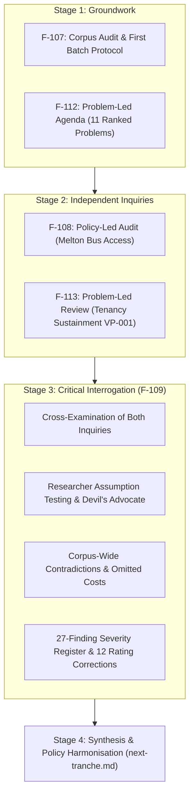

# Stage 3: Challenging Victorian Policy Weaknesses, Contradictions, and Consequences (F-109)

> **Research — not adopted Fusion policy**

- **Programme:** Victorian State Policy Research Programme (Coordinated under F-105).
- **Issue Reference:** Issue F-109 (`01a1452e-4aa0-7d85-8845-c062d00799b7`).
- **Lead Author & Identity:** Policy Researcher (`d51839b3-5b90-425d-89b4-4adb15d75317`), acting on behalf of ethan.c.
- **Date & AEDT Timestamp:** 17 October 2026.
- **Acceptance Status:** Submitted for human review; issue set to `in_review`.
- **Methodology & Review Notice:** Conducted using academic research skills (`deep-research`, `academic-paper-reviewer`). Employs role-separated adversarial challenge, Devil's Advocate stress-testing, and causal cross-examination. **This is methodological critique and internal research; it does not constitute independent human peer review or adopted party policy.**

---

## 1. Overview and Synthesis

Stage 3 represents the critical synthesis checkpoint of the Victorian research programme. Having completed and accepted Stage 2's independent inquiries—the policy-led examination of Melton bus access (F-108) and the problem-led evaluation of tenancy sustainment for low-income renters (F-113)—this ticket cross-examines both inquiries against one another and against Fusion Party Victoria's wider 41-policy adopted corpus.



### Key Analytical Takeaways:
1. **The Spatial-Social Divide:** Suburban disadvantage cannot be resolved by spatial timetable engineering alone while acute housing eviction churn continues. Conversely, preserving tenancies in isolated transit deserts traps families in deep transport poverty. Transport and housing policy must be co-designed.
2. **The Missing Social Platform:** Fusion's adopted platform of 41 policies is concentrated in transport engineering, urban zoning, and democratic integrity, but **contains almost zero adopted policy in healthcare, family violence, emergency shelter, climate adaptation, or child protection**—the areas comprising >70% of state spending.
3. **No Confirmed Contradictions Under Applied Review Criteria:** Operative text, geographic scope, conditionality, and time horizons were tested against strict evidentiary standards (requiring two actual commitments in adopted policies that genuinely cannot coexist as written). **No confirmed contradictions were identified among the 41 adopted policies under the applied review criteria.** The findings represent operational rostering dependencies (timetable shifts), intentional policy design mechanisms (FlexiRide standards exposing microtransit unit costs to drive fixed-route conversion), intervention design safeguards (survivor-centred domestic violence screening and consent-based safe-exit options), research evidence corrections (non-cashable Treasury offsets in F-113), implementation sequencing, and platform scope omissions.
4. **Evidence Corrections:** Factually validated Sunday bus departure clustering and baseline homelessness figures, while refuting categorical zero-cost claims, microtransit expansion guarantees, and untargeted rent arrears efficiency.

---

## 2. Directory Structure and Deliverable Index

All artifacts in this package are self-contained, reproducible, and verifiable via automated scripts:

| File | Type | Description |
| --- | --- | --- |
| [brief.md](brief.md) | Executive Brief | High-level synthesis of findings, absence of policy contradictions, rating corrections, and human deliberation points. |
| [cross-examination.md](cross-examination.md) | Analytical Report | In-depth cross-examination of policy-led and problem-led inquiries; critique of F-112 problem definitions and rankings. |
| [critique-policy-led.md](critique-policy-led.md) | Methodological Critique | Devil's Advocate stress-test of F-108 (Melton bus access) and transport policies; tests researcher assumptions and operational barriers. |
| [critique-problem-led.md](critique-problem-led.md) | Methodological Critique | Devil's Advocate stress-test of F-113 (Tenancy sustainment) and housing policies; examines deadweight loss, landlord capture, and VCAT debt traps. |
| [corpus-contradictions.md](corpus-contradictions.md) | Systemic Review | Detailed audit of operative text, policy tensions, sequencing dependencies, and verified strengths across all 41 adopted policies. |
| [severity-register.csv](severity-register.csv) | Data Register | Machine-readable register of 27 distinct findings (F01–F27) classifying issue types, severities, affected groups, counterarguments, and actions. |
| [challenge-matrix.csv](challenge-matrix.csv) | Data Matrix | Structured mapping of policies and problems across 8 challenge dimensions (omitted costs, distributional impacts, risks, falsifiers). |
| [rating-corrections.csv](rating-corrections.csv) | Data Register | Audit table detailing 12 specific evidence rating corrections and verified strengths across Stage 2 claims. |
| [sources.md](sources.md) | Bibliography | Annotated bibliography with verifiable citations, DOIs, legislation, and ABS/VAGO/AIHW/VCAT data sources (S01–S20). |
| [next-tranche.md](next-tranche.md) | Strategic Roadmap | Prioritised recommendations for Stage 4 workstreams (policy harmonisation and second problem batch). |
| [LEARNINGS.md](LEARNINGS.md) | Methodological Retrospective | Candid review of Stage 3 errors, analysis of the 7 failure modes, and reusable research quality checklist. |
| [validate.py](validate.py) | Verification Script | Self-contained Python test suite validating all schemas, links, citation resolution, and prominent labels. |
| [validation.json](validation.json) | Validation Receipt | Machine-readable receipt confirming all integrity test suites pass. |

---

## 3. Severity Register Summary (F01–F27)

The severity register (`severity-register.csv`) categorises all 27 identified findings by impact and confirmed status:

- **CRITICAL Findings (2):**
  - `F16`: Family Violence Co-Tenancy Liability (F-113 A07) — Critical survivor safety risk in intervention design: emergency rent arrears grants must provide survivor-centred screening, confidential support, informed consent, and safe-exit pathways (non-mandatory lease severance).
  - `F18`: Severe Scope Omission of Core Social Policy — Confirmed systemic platform omission: platform completely lacks adopted policies in health, family violence, and climate adaptation (>70% of state budget).
- **MAJOR Findings (14):**
  - Substantive fiscal, structural, procedural, and distributional risks with high likelihood or severe systemic consequences: 1km transit sprawl hazard (`F04`), capital rail borrowing vs operating bus hours (`F06`), commuter parking levies in transit deserts (`F07`), targeting efficiency in cash arrears (`F09`), landlord subsidy capture (`F10`), 24-month chronic poverty exit (`F11`), VCAT repayment hardship under s 330A (`F12`), VCAT listing congestion (`F13`), windfall gains tax vs development feasibility (`F14`), social housing capacity ceilings (`F15`), research evidence correction on non-cashable Treasury offsets (`F17`), siloed domestic violence framing (`F20`), child protection sentinel suppression (`F22`), and universal dividend vs crisis triage in deficit (`F23`).
- **MINOR Findings (9):**
  - Proportionate operational dependencies, minor scheduling adjustments, localized impacts, and internal ranking sensitivities: timetable staggering depot rostering (`F01`), Melton Station rail transfer synchronization (`F02`), FlexiRide transition operational decision framework (`F03`), direct grid 800m walking displacement in localized pockets (`F05`), bus franchise clawback contracting separation (`F08`), housing tractability scoring sensitivity in internal agenda (`F19`), outer transport poverty ranking indicator sensitivity (`F21`), station upzoning vs citizen juries drafting clarification (`F24`), and sovereign fund debt borrowing vs dividend sequencing (`F25`).
- **VERIFIED STRENGTHS / NO MATERIAL WEAKNESS (2):**
  - `F26`: Open government presumption and whistleblower integrity protections are robust, sound, and evidence-aligned.
  - `F27`: Melton Sunday scheduled departure clustering on Brooklyn Road (Route 457/459) is a mathematically verified GTFS fact.

---

## 4. Verification and Reproducibility

To run the offline verification test suite:

```bash
python3 vic/policy-challenge-f-109/validate.py
```

The script inspects all Markdown and CSV files, confirms schema compliance, verifies cross-references to `sources.md`, checks relative markdown link resolution, confirms absence of runtime-local deliverable paths, and writes `validation.json`.
