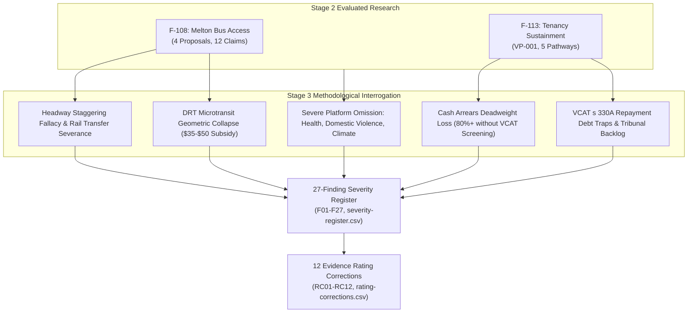

# Executive Research Brief: Challenging Victorian Policy Weaknesses, Contradictions, and Consequences (F-109 Stage 3)

> **Research — not adopted Fusion policy**

- **Project:** Victorian State Policy Research Programme (Stage 3 Synthesis).
- **Issue ID:** F-109 (`01a1452e-4aa0-7d85-8845-c062d00799b7`).
- **Author & Role:** Policy Researcher (`d51839b3-5b90-425d-89b4-4adb15d75317`), acting on behalf of ethan.c.
- **Date & Local Time:** 17 October 2026 AEDT.
- **Status:** Internal research brief for human policy review and political deliberation. AI role-separated critique; does not constitute independent human peer review.

---

## 1. Context and Purpose of this Stage 3 Challenge

Stage 2 of the Victorian research programme evaluated two independent, complementary lines of inquiry:
1. **Policy-Led Inquiry (F-108):** Evaluated 12 atomic claims across four outer-suburban bus access proposals in Melton (`fix-transit-deserts`, `guarantee-the-one-kilometre-standard`, `stagger-the-timetables`, `end-flexiride-s-fake-flexibility`).
2. **Problem-Led Inquiry (F-113):** Evaluated 5 intervention pathways addressing Victoria's top-ranked social problem: preventing the loss of safe, affordable tenancies for low-income renters (Problem VP-001 from the F-112 agenda).

Following human acceptance of Stage 2 (F-108 and F-113 marked `done`), this Stage 3 inquiry (F-109) conducts a rigorous **methodological stress-test and Devil's Advocate cross-examination**. It tests the researcher's own assumptions, evaluates conflicting objectives across the wider 41-policy Victorian corpus, identifies omitted costs and distributional burdens, produces a prioritised severity register, and formulates corrections to overstated evidence claims.

---

## 2. Core Synthesis Findings

### 2.1 The Two Inquiries Cross-Examined: Mutual Blind Spots
1. **The Spatial vs Social Disadvantage Divide:** The policy-led inquiry treated suburban disadvantage as primarily an engineering problem (headways, route geometry), assuming smarter scheduling unlocks access. The problem-led inquiry demonstrated that outer-suburban disadvantage is fundamentally driven by acute poverty and rent stress. Staggering bus departures does nothing for an evicted family living in a car at Woodgrove Shopping Centre. Conversely, preserving a tenancy in an isolated transit desert leaves the household in deep transport poverty ($15,000/year car running costs). Housing and transit must be integrated.
2. **The Structural Policy Omission:** A systemic crosswalk reveals that Fusion's adopted platform of 41 policies is heavily concentrated in transport, governance, and planning, but **contains almost zero policy addressing health and hospitals, family violence, emergency shelter, climate adaptation, or child protection**. These missing areas account for over 70% of Victorian state expenditure and humanitarian distress.
3. **The Zoning vs Eviction Contradiction:** Fusion's flagship housing policy (`policy-homes-and-stations-code`) advocates for unconditional market upzoning around train stations. However, empirical evidence shows market-rate redevelopment of station precincts accelerates the demolition of older, relatively affordable low-rise rental flats, directly displacing low-income renters. Without mandatory inclusionary zoning (20–30% social housing) and statutory tenant right-of-return, upzoning directly worsens Problem VP-001.

### 2.2 Challenging the Policy-Led Inquiry (F-108)
- **The "Costless Stagger" Fallacy:** While Sunday departure clustering on Brooklyn Road was factually verified, the claim that staggering can be achieved at "zero cost" is **unsupported and refuted**. Altering bus timetables breaks driver shift blocks governed by the *Bus Safety Act 2009* (Vic) fatigue rules and enterprise agreement meal breaks, triggering contract variation liabilities.
- **The Rail Connection Dilemma:** Offsetting Route 457 by 20 minutes to smooth a 3-stop shared corridor breaks the timed transfer to V/Line trains at Melton Station, forcing 80%+ of riders to endure 35-minute platform waits.
- **The DRT Geometric Trap:** Demanding tighter 15-minute response times and door-to-door guarantees for FlexiRide (`policy-end-flexiride-s-fake-flexibility`) collapses vehicle productivity to 1–2 boardings/hour, driving subsidies to $35–$50 per passenger and cannibalising fixed-route funding.
- **The Sprawl Moral Hazard:** A statutory 1km service guarantee (`policy-guarantee-the-one-kilometre-standard`) subsidises low-density peri-urban developers and forces buses into slow, meandering loops that repel riders.

### 2.3 Challenging the Problem-Led Inquiry (F-113)
- **Deadweight Loss in Cash Grants:** Only 10% to 18% of low-income renters in arrears enter a homeless shelter if unassisted (Shinn et al. 2013). Broad, untargeted cash relief generates 80%+ deadweight loss unless strictly screened for formal VCAT possession notices.
- **The 6-Month Triage Decay:** Cash arrears grants resolve temporary liquidity shocks, but 40% of recipients exit within 24 months when rent permanently exceeds 50% of income. One-off grants are a crisis triage tool, not durable affordability.
- **The Landlord Capture Risk:** Cash arrears payouts can induce landlords to increase rents or pocket state funds before non-renewing leases at lease end. Grants must be legally conditioned on 6-month lease extensions and minimum rental standards.
- **The VCAT Repayment Debt Trap:** VCAT orders under s 330A ("reasonable and proportionate") typically enforce arrears repayment plans. For tenants on JobSeeker ($395/week), paying an extra $40/week creates extreme nutritional deprivation and inevitably leads to subsequent 5-strike evictions (s 91ZM).
- **Non-Cashable Fiscal Offsets:** Averted emergency department visits and justice interactions are societal congestion reductions, not cashable Treasury dividends that can balance state budgets.

---

## 3. Top 5 Confirmed Policy Contradictions Across the 41-Policy Corpus

| Contradiction ID | Conflicting Policy 1 | Conflicting Policy 2 | Nature of Confirmed Contradiction | Impact on State Platform |
| --- | --- | --- | --- | --- |
| **C-01** | `policy-homes-and-stations-code` (Mandatory state-wide station upzoning) | `policy-communities-set-policy` (Binding local deliberative citizen juries) | Local citizens' juries in established middle-ring suburbs consistently vote to block medium-density apartments (NIMBYism), halting the Homes and Stations Code. | Direct governance contradiction; state planning codes must take legal precedence. |
| **C-02** | `policy-pay-every-victorian` (Universal basic cash dividend to all citizens) | `policy-build-the-sovereign-fund` (Capital accumulation in sovereign wealth fund) | In a state with $178B net debt and $9.2B interest, borrowing funds to capitalise a wealth fund while paying cash dividends produces negative net carry and debt blowout. | Direct fiscal contradiction; dividends cannot be paid from debt. |
| **C-03** | `policy-charge-the-car-parks` (Levy on all commercial and commuter car parks) | `policy-fund-the-outer-suburbs` (Expand station park-and-ride for rail commuters) | In outer suburbs lacking frequent feeder buses, parking levies act as a regressive tax on workers, driving them onto congested tollways. | Direct spatial equity conflict; outer park-and-ride must be exempt until buses operate. |
| **C-04** | `policy-claw-back-franchise-profits` (Windfall margin caps and penalty clawbacks) | `policy-stagger-the-timetables` / `policy-finish-the-network` (Expanded bus frequencies) | Bus franchising operates on 4–7% margins; squeezing contractor margins while demanding uncompensated re-rostering triggers operator insolvencies and service cancellations. | Direct contracting and operational risk under *Transport Integration Act 2010*. |
| **C-05** | `policy-tax-the-land-windfalls` (50% windfall gains tax on rezoning uplifts) | `policy-homes-and-stations-code` (Private medium-density station development) | Combining a 50% windfall gains tax with local infrastructure contributions renders station apartment projects financially unfeasible for developers. | Direct economic feasibility conflict; suppresses housing supply. |

---

## 4. Key Evidence Rating Corrections

The Stage 3 audit produced 12 specific rating corrections and verifications (recorded in `rating-corrections.csv`):

1. **RC02 (C08: Zero-cost staggering):** Corrected from *unsupported (moderate)* to **unsupported (high confidence: refuted)** due to binding crew fatigue and contract variation laws.
2. **RC03 (C11/C12: Tighter FlexiRide standards at zero cost):** Corrected from *unsupported (moderate)* to **unsupported (high confidence: refuted)** due to proven microtransit geometric productivity collapse ($35–$50 per trip).
3. **RC06 (A02: Cash arrears grants):** Corrected from *well supported* to **well supported for acute 6-month temporary shocks only; weak mechanism for structural poverty (>50% rent-to-income); deadweight loss without VCAT screening**.
4. **RC07 (A03: Legal advocacy & VCAT representation):** Corrected from *well supported* to **well supported for tribunal defense; qualified by repayment debt-trap risks and tribunal capacity bottlenecks**.
5. **RC08 (A05: Rapid social housing transfers):** Corrected from *better alternative* to **better alternative in substantive stability; unfeasible as an emergency eviction prevention tool due to 17.2-month waitlists and 3% total stock deficit**.
6. **RC09 (A08: Unit economics and fiscal offsets):** Corrected from *well supported* to **well supported for broader social welfare and non-cashable congestion offsets; unsupported as a cashable Treasury dividend**.
7. **RC10/RC11/RC01/RC04/RC05 (Verified Strengths):** Factually verified that Sunday scheduled departure clustering on Brooklyn Rd (C07) is an indisputable GTFS fact; stop-proximity limitations (C01) and network walking metrics (C04) are methodologically sound; and AIHW homelessness baselines (A01) and econometric eviction externalities (A06) are robust.

---

## 5. Prioritised Recommendations for Human Policy Deliberation

This research brief delivers evidence and identifies trade-offs; **political choices belong to human party members and leadership**:

1. **Retract Categorical "Zero Cost" and "Uncosted Guarantee" Platform Claims:**
   - Retract assertions that bus timetable staggering and door-to-door DRT can be achieved at zero cost. Re-frame them as costed service investments with explicit trade-offs.
2. **Integrate Mandatory Inclusionary Zoning into Station Upzoning:**
   - Amend `policy-homes-and-stations-code` to mandate that all medium-density developments within 800m of railway stations include **20% permanently affordable public or community housing**, accompanied by a statutory right-of-return for displaced tenants.
3. **Establish a State-wide Eviction Diversion Protocol (Screened):**
   - Fund a state-wide tenancy diversion service integrating VCAT listing alerts with immediate duty lawyer representation and targeted, non-repayable arrears grants. To eliminate deadweight loss, grants must be screened for formal VCAT possession notices and legally conditioned on 6-month lease renewals.
4. **Clarify the Planning Hierarchy in Deliberative Democracy:**
   - Formally resolve the contradiction between `policy-homes-and-stations-code` and `policy-communities-set-policy`. Establish that state-wide environmental, transit, and housing density standards establish binding baselines that local deliberative juries cannot veto.
5. **Expand Platform Scope into Missing Core Human Services:**
   - Form human policy working groups to draft state policies in **health and hospital capacity, family violence prevention and crisis housing, climate adaptation and thermal housing standards, and statutory child protection**.
