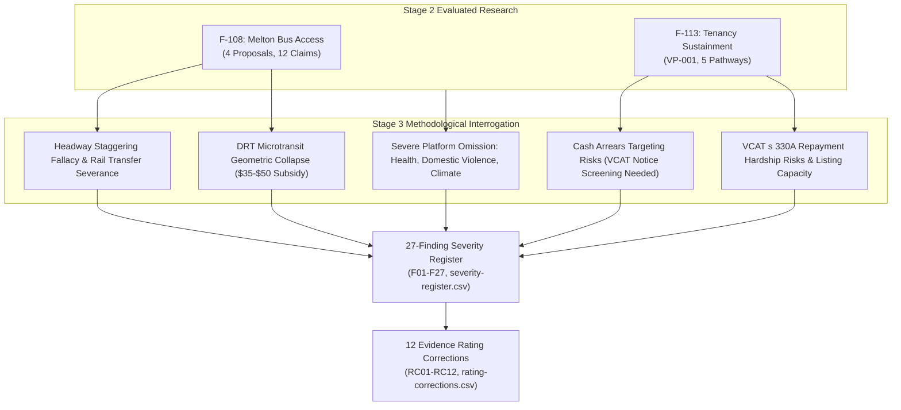

# Executive Research Brief: Challenging Victorian Policy Weaknesses, Contradictions, and Consequences (F-109 Stage 3)

> **Research — not adopted Fusion policy**

- **Project:** Victorian State Policy Research Programme (Stage 3 Synthesis).
- **Issue ID:** F-109 (`01a1452e-4aa0-7d85-8845-c062d00799b7`).
- **Author & Role:** Policy Researcher (`d51839b3-5b90-425d-89b4-4adb15d75317`), acting on behalf of ethan.c.
- **Date & Local Time:** 17 October 2026 AEDT.
- **Status:** Internal research brief for human policy review and political deliberation. AI role-separated critique; does not constitute independent human peer review.

---

## 1. Context and Purpose of this Stage 3 Challenge

Stage 2 of the Victorian research programme evaluated two independent, complementary lines of inquiry:
1. **Policy-Led Inquiry (F-108):** Evaluated 12 atomic claims across four outer-suburban bus access proposals in Melton (`fix-transit-deserts`, `guarantee-the-one-kilometre-standard`, `stagger-the-timetables`, `end-flexiride-s-fake-flexibility`).
2. **Problem-Led Inquiry (F-113):** Evaluated 5 intervention pathways addressing Victoria's top-ranked social problem: preventing the loss of safe, affordable tenancies for low-income renters (Problem VP-001 from the F-112 agenda).

Following human acceptance of Stage 2 (F-108 and F-113 marked `done`), this Stage 3 inquiry (F-109) conducts a rigorous **methodological stress-test and Devil's Advocate cross-examination**. It tests the researcher's own assumptions, evaluates conflicting objectives across the wider 41-policy Victorian corpus, identifies omitted costs and distributional burdens, produces a prioritised severity register, and formulates corrections to overstated evidence claims.

---

## 2. Core Synthesis Findings

### 2.1 The Two Inquiries Cross-Examined: Mutual Blind Spots
1. **The Spatial vs Social Disadvantage Divide:** The policy-led inquiry treated suburban disadvantage as primarily an engineering problem (headways, route geometry), assuming smarter scheduling unlocks access. The problem-led inquiry demonstrated that outer-suburban disadvantage is fundamentally driven by acute poverty and rent stress. Staggering bus departures does nothing for an evicted family living in a car at Woodgrove Shopping Centre. Conversely, preserving a tenancy in an isolated transit desert leaves the household in deep transport poverty ($15,000/year car running costs). Housing and transit must be integrated.
2. **The Structural Policy Omission:** A systemic crosswalk reveals that Fusion's adopted platform of 41 policies is heavily concentrated in transport, governance, and planning, but **contains almost zero policy addressing health and hospitals, family violence, emergency shelter, climate adaptation, or child protection**. These missing areas account for over 70% of Victorian state expenditure and humanitarian distress.
3. **The Zoning vs Tenant Protection Tension:** Fusion's flagship housing policy (`policy-homes-and-stations-code`) advocates for code-assessable medium-density zoning around train stations to expand supply. However, rapid redevelopment of station precincts can increase pressures on older, low-rent private flats, risking tenant displacement before new supply filters down. Deliberation should consider companion tenant protection options (such as voluntary density bonuses for affordable units, relocation assistance, or statutory notice protections) to protect vulnerable tenants without undermining project viability.

### 2.2 Challenging the Policy-Led Inquiry (F-108)
- **Operational Rostering in Timetable Staggering:** While Sunday departure clustering on Brooklyn Road was factually verified, existing driver fatigue rules (*Bus Safety Act 2009*) do not inherently prevent shifting departures by 15 minutes. However, altering bus timetables requires re-rostering driver shift blocks, meal breaks, and depot layovers, incurring contract variation and operational adjustment costs rather than being delivered at "zero resource cost."
- **The Rail Connection Dilemma:** Offsetting Route 457 by 20 minutes to smooth a 3-stop shared corridor breaks the timed transfer to V/Line trains at Melton Station, forcing 80%+ of riders to endure 35-minute platform waits.
- **The DRT Service Standard Mechanism:** Imposing stringent 15-minute lead times and door-to-door delivery on FlexiRide (`policy-end-flexiride-s-fake-flexibility`) is an intentional policy mechanism designed to expose the poor economics of microtransit ($35–$50 per passenger) and justify replacement with scheduled fixed-route buses. The policy explicitly anticipates costing changes at renewal; the key dependency is ensuring an adequate transition mechanism to avoid service gaps.
- **The Sprawl Moral Hazard:** A statutory 1km service guarantee (`policy-guarantee-the-one-kilometre-standard`) subsidises low-density peri-urban developers and forces buses into slow, meandering loops that repel riders.

### 2.3 Challenging the Problem-Led Inquiry (F-113)
- **Targeting Specificity vs Housing Stability in Cash Grants:** While empirical studies show that only 10% to 18% of low-income renters facing arrears enter formal homelessness shelters if unassisted (Shinn et al. 2013), this metric does not imply that remaining assistance is wasted; preventing eviction avoids severe informal instability, school disruption, and acute hardship. However, untargeted cash relief exhibits significant targeting inefficiency compared to assistance screened for formal VCAT possession lists.
- **The 6-Month Triage Decay:** Cash arrears grants resolve temporary liquidity shocks, but 40% of recipients exit within 24 months when rent permanently exceeds 50% of income. One-off grants are a crisis triage tool, not durable affordability.
- **The Landlord Capture Risk:** Cash arrears payouts can induce landlords to increase rents or pocket state funds before non-renewing leases at lease end. Grants must be legally conditioned on 6-month lease extensions and minimum rental standards.
- **The VCAT Repayment Hardship Risk:** VCAT orders under s 330A ("reasonable and proportionate") typically enforce arrears repayment plans. For households on deeply inadequate income support (e.g. JobSeeker at ~$395/week), committing an extra $30–$50/week creates severe material hardship, increasing the risk of subsequent default under s 91ZM.
- **Research Evidence Correction on Fiscal Offsets:** Averted emergency department visits and justice interactions are societal and economic congestion reductions, not cashable Treasury dividends that can balance state budgets. No adopted policy claimed these as cash revenues; this was an analytical overstatement in F-113.

---

## 3. Evaluation of Policy Tensions, Implementation Dependencies, and Absence of Confirmed Contradictions

Following human review, proposed platform interactions were rigorously re-evaluated against operative policy text, institutional levels, geographic scope, and time horizons. A *confirmed contradiction* requires two actual commitments in adopted policies that genuinely cannot coexist as written. **No confirmed contradictions were identified among the 41 adopted policies under the applied review criteria.**

The corpus interactions and candidate findings are properly classified as follows:

| Ref ID | Policy / Mechanism 1 | Policy / Mechanism 2 | Re-Evaluated Classification & Mechanics | Deliberation & Implementation Guidance |
| --- | --- | --- | --- | --- |
| **T-01 (F24)** | `policy-homes-and-stations-code` (Statewide station upzoning) | `policy-communities-set-policy` (Deliberative citizen juries) | **Drafting Clarification & Statutory Hierarchy:** Key Point 2 of `policy-communities-set-policy` already specifies that assemblies cannot block compliant housing or override statewide codes. | Confirm and codify the statutory baseline in administrative instruments so local juries focus on streetscape, active transit, and public realm amenities. |
| **T-02 (F25)** | `policy-build-the-sovereign-fund` (Capital accumulation) | `policy-pay-every-victorian` (Universal basic dividend) | **Implementation Dependency & Temporal Sequencing:** Dividend is explicitly conditioned on audited net surplus after debt service, maintenance, and reserves; capital accumulation is the multi-decade prior phase. | Clarify platform timeline: sovereign fund capital preservation precedes surplus distribution; no deficit borrowing for cash payouts. |
| **T-03 (F07)** | `policy-charge-the-car-parks` (Commercial parking levy) | `policy-fund-the-outer-suburbs` (Outer commuter park-and-ride) | **Geographic Application & Implementation Sequencing:** Summary specifies inner-urban commercial parking; outer station park-and-rides require geographic exemption until feeder bus networks are delivered. | Explicitly exempt outer-suburban rail park-and-rides from parking levies until feeder buses achieve 15-minute 7-day frequencies. |
| **T-04 (F08)** | `policy-claw-back-franchise-profits` (Contractual margin auditing) | `policy-stagger-the-timetables` / `policy-finish-the-network` (Expanded bus frequencies) | **Distinct Contractual Mechanisms & Operational Risk:** Recovering unjustified excess margins at contract renewal is distinct from compensating operators for newly commissioned service hours. | Maintain separate contractual mechanisms: robust margin transparency upon franchise renewal alongside fair, audited unit rates for new service hours. |
| **T-05 (F14)** | `policy-tax-the-land-windfalls` (50% windfall gains tax) | `policy-homes-and-stations-code` (Medium-density station development) | **Empirical Feasibility Question & Policy Tension:** Windfall Gains Tax is existing 2021 law hypothecated to transit; whether combined taxes and infrastructure levies impair project viability is an empirical modeling question. | Commission site-specific residual land value pro-forma modeling to calibrate value capture rates against development viability. |
| **O-01 (F01)** | `policy-stagger-the-timetables` (Headway staggering) | Driver fatigue rules & split-shift rosters (*Bus Safety Act 2009*) | **Operational Rostering & Cost Dependency:** Fatigue rules do not inherently prevent shifting departures by 15 minutes; adjustments are accommodated via driver roster modifications and contract variations. | Model Melton depot vehicle-block and driver-duty rosters to cost required layover adjustments before issuing timetable directives. |
| **O-02 (F03)** | `policy-end-flexiride-s-fake-flexibility` (Stringent DRT standards) | Geometric microtransit productivity ($35–$50 subsidy/trip) | **Intentional Policy Design Rationale & Transition Dependency:** Imposing high standards is deliberately designed to expose DRT economics and drive conversion to fixed-route buses. | Establish transparent unit costing benchmarks and an operational decision framework within DTP service planning to transition microtransit resources into fixed-route buses where standards demonstrate superior fixed-route efficiency; avoid unnecessary statutory triggers. |
| **S-01 (F16)** | Proposed tenancy arrears grants (F-113) | Domestic violence victim-survivor safety | **Intervention Design Safeguard in Research Proposal:** No adopted policy preserves unsafe joint tenancies; survivor-centred screening, confidential support, informed consent, and safe-exit pathways (including RTA s 91V) are critical operational safeguards in research proposal F-113, not an adopted policy contradiction. | Embed survivor-centred screening, confidential casework support, informed consent, and facilitated access to RTA s 91V safe-exit pathways into tenancy intervention guidelines; do not make lease severance mandatory or automatic. |
| **R-01 (F17)** | Averted hospital/court crisis presentations (F-113 A08) | State Treasury budget cashability | **Research Evidence Rating Correction Originating in F-113:** Adopted policies do not claim cash Treasury revenue from congestion offsets; this was a research overstatement. | Separate societal cost-benefit valuations from cashable state budget offsets in program business cases. |

---

## 4. Key Evidence Rating Corrections

The Stage 3 audit produced 12 specific rating corrections and verifications (recorded in `rating-corrections.csv`):

1. **RC02 (C08: Zero-cost staggering):** Corrected from *unsupported (moderate)* to **well supported as a scheduling improvement with operational rostering and contract variation dependencies (zero-cost claim refuted; schedule shift requires depot rostering)**.
2. **RC03 (C11/C12: Tighter FlexiRide standards at zero cost):** Corrected from *unsupported (moderate)* to **valid policy mechanism designed to expose microtransit cost failure; transition to fixed-route buses managed via operational decision frameworks and transparent costing (no statutory triggers required)**.
3. **RC06 (A02: Cash arrears grants):** Corrected from *well supported* to **well supported for acute 6-month temporary shocks; weak mechanism for structural poverty (>50% rent-to-income); requires VCAT notice screening to avoid targeting inefficiency**.
4. **RC07 (A03: Legal advocacy & VCAT representation):** Corrected from *well supported* to **well supported for tribunal defense; qualified by repayment hardship risks and tribunal capacity bottlenecks**.
5. **RC08 (A05: Rapid social housing transfers):** Corrected from *better alternative* to **better alternative in substantive stability; unfeasible as an emergency eviction prevention tool due to 17.2-month waitlists and 3% total stock deficit**.
6. **RC09 (A08: Unit economics and fiscal offsets):** Corrected from *well supported* to **well supported for broader social welfare and non-cashable congestion offsets; research correction to F-113 (unsupported as a cashable Treasury dividend; no adopted policy claimed cash savings)**.
7. **RC10/RC11/RC01/RC04/RC05 (Verified Strengths):** Factually verified that Sunday scheduled departure clustering on Brooklyn Rd (C07) is an indisputable GTFS fact; stop-proximity limitations (C01) and network walking metrics (C04) are methodologically sound; and AIHW homelessness baselines (A01) and econometric eviction externalities (A06) are robust.

---

## 5. Prioritised Recommendations for Human Policy Deliberation

This research brief delivers evidence and identifies trade-offs; **political choices belong to human party members and leadership**:

1. **Retract Categorical "Zero Cost" and "Uncosted Guarantee" Platform Claims:**
   - Retract assertions that bus timetable staggering and door-to-door DRT can be achieved at zero cost. Re-frame them as costed service investments with explicit trade-offs.
2. **Deliberate Tenant Protection Options Alongside Station Upzoning:**
   - Consider companion policy options alongside `policy-homes-and-stations-code` to mitigate tenant displacement and expand affordable housing, such as: (a) voluntary density bonus incentives for developments incorporating permanent social/affordable units; (b) statutory right-of-return and relocation assistance for tenants displaced by redevelopment of low-rise stock; or (c) state acquisition of turnkey dwellings within station precincts.
3. **Establish a State-wide Eviction Diversion Protocol (Screened):**
   - Fund a state-wide tenancy diversion service integrating VCAT listing alerts with immediate duty lawyer representation and targeted, non-repayable arrears grants. To maximize targeting efficiency, grants should be screened for formal VCAT possession notices and conditioned on 6-month lease extensions.
4. **Codify Planning Hierarchy in Deliberative Instruments:**
   - Ensure legislative drafting for `policy-communities-set-policy` explicitly reflects its adopted Key Point 2 carve-out, confirming that statewide planning and density baselines govern statutory approvals while citizen assemblies deliberate on local public realm and community infrastructure.
5. **Expand Platform Scope into Missing Core Human Services:**
   - Form human policy working groups to draft state policies in **health and hospital capacity, family violence prevention and crisis housing, climate adaptation and thermal housing standards, and statutory child protection**.
