# Corpus-Wide Analysis: Operative Provisions, Policy Tensions, Sequencing Dependencies, and Drafting Ambiguities

> **Research — not adopted Fusion policy**

- **Scope:** Systemic review across Fusion Party Victoria's 41 adopted platform policies (Sanity corpus snapshot October 2026).
- **Analytical Standard:** Quotes operative policy provisions verbatim (including qualifications, conditionality, and funding notes), testing whether paired policies apply to the same circumstances, geography, institutions, and time horizons.
- **Classification Rubric:**
  - **Confirmed Contradiction:** Reserved strictly for commitments that genuinely cannot coexist as written under any plausible interpretation.
  - **Implementation Dependency / Sequencing:** Policies whose co-existence requires explicit chronological sequencing or prior operational conditions.
  - **Policy Tension / Distributional Trade-Off:** Policies whose simultaneous pursuit creates competing resource demands or divergent stakeholder impacts requiring political balancing.
  - **Drafting Ambiguity / Clarification:** Policies whose high-level principles are compatible, but where statutory drafting requires explicit definitions or carve-outs to avoid misinterpretation.
  - **Evidence Gap / Empirical Question:** Propositions whose compatibility hinges on empirical parameters requiring quantitative modeling rather than deductive critique.
- **Author & Identity:** Policy Researcher (`d51839b3-5b90-425d-89b4-4adb15d75317`), acting on behalf of ethan.c.
- **Status:** Internal research deliverable for human policy review and political deliberation. AI role-separated critique; does not constitute independent human peer review.

---

## 1. Re-Examination of the Five Primary Policy Intersections

Following human review on Issue F-109, this section re-examines the five policy intersections previously labelled as confirmed contradictions. By examining the operative policy text, explicit qualifications, conditionality, and jurisdictional scope, each intersection is reclassified with proportionate evidentiary rigor.

```mermaid
flowchart TD
    subgraph S1["Intersection 1: Station Density vs Local Deliberation"]
        A1["Homes and Stations Code<br/>(Statewide baseline: 800m station upzoning)"]
        A2["Communities Set Policy<br/>(Local participatory budgeting & citizen panels)"]
        A3{"Operative Text Test"}
        A1 --> A3
        A2 --> A3
        A3 -->|"Key Point 2 explicitly excludes planning/housing from local veto"| A4["Classification: Drafting Clarification<br/>(Ensure enabling statute preserves baseline carve-out)"]
    end

    subgraph S2["Intersection 2: Sovereign Wealth Fund vs Dividends"]
        B1["Build the Sovereign Fund<br/>(20-30 yr capital accumulation: $100B-$250B)"]
        B2["Pay Every Victorian<br/>(Dividend from fund returns)"]
        B3{"Operative Text Test"}
        B1 --> B3
        B2 --> B3
        B3 -->|"Funding field: Paid ONLY from audited net surplus after debt service"| B4["Classification: Implementation Dependency<br/>(Sequential & complementary: accumulation precedes distribution)"]
    end

    subgraph S3["Intersection 3: Parking Pricing vs Outer Suburban Equity"]
        C1["Charge the Car Parks<br/>(Inner-urban commercial parking levy)"]
        C2["Fund the Outer Suburbs<br/>(Station park-and-ride in growth areas)"]
        C3{"Operative Text Test"}
        C1 --> C3
        C2 --> C3
        C3 -->|"Summary specifies inner-urban; revenue hypothecated to outer transit"| C4["Classification: Implementation Sequencing<br/>(Geographic boundary: outer stations exempt until feeder buses operate)"]
    end
```

---

### 1.1 Intersection 1: Station Upzoning vs Citizen Juries (`homes-and-stations-code` vs `communities-set-policy` / `citizens-in-every-room`)

#### Operative Provisions Quoted
- **`policy-homes-and-stations-code` (/policies/12):**
  - *Summary:* "Establish an automatic, code-assessable planning standard for homes within 800 metres of railway stations."
  - *Key Point 0:* "Medium-density homes (up to four storeys, or higher within 400m) are code-assessable if they meet objective siting, daylight and design rules."
  - *Key Point 2:* "Remove third-party appeals for proposals that comply with the code, while retaining council oversight for compliance."
- **`policy-communities-set-policy` (/policies/22):**
  - *Summary:* "Give communities direct control over a defined share of discretionary local public investment through participatory budgeting—**without creating a local veto over housing, land use or statewide infrastructure**."
  - *Key Point 1:* "Residents vote on a defined pool of discretionary local capital spending for public spaces, walking and cycling links, community facilities, local environmental works and similar improvements."
  - *Key Point 2:* "**Participatory budgeting cannot block compliant housing, override statewide planning rules or housing targets, or give existing residents a veto over who may live in a neighbourhood.**"
  - *Economic Logic:* "**Keeping land-use entitlements and essential infrastructure outside the mechanism prevents incumbent residents from imposing exclusionary costs on future residents or blocking projects whose benefits extend beyond one neighbourhood.**"
- **`policy-citizens-in-every-room` (/policies/23):**
  - *Summary:* "Use representative citizens’ panels for major, genuinely contested long-term questions to improve deliberation and scrutiny—**without creating a parallel legislature or another veto point for routine housing and infrastructure delivery**."
  - *Key Point 0:* "Convene stratified citizens’ panels for selected major long-term or institutionally difficult questions, **not every Bill or routine administrative decision**."
  - *Key Point 2:* "Panels make public recommendations and Parliament or government must formally respond; **elected institutions remain responsible for the final decision** unless a separate lawful referendum is required."

#### Compatibility Assessment
- **Circumstances & Authority:** These policies operate at distinct, hierarchically separated levels of authority. The *Homes and Stations Code* establishes a statewide statutory planning baseline enacted by the Parliament of Victoria. *Communities Set Policy* operates strictly at the local neighbourhood level over discretionary capital spending pools.
- **Explicit Exclusions:** The adopted text of `policy-communities-set-policy` **already contains an explicit, unequivocal carve-out** prohibiting participatory panels from overriding planning rules or blocking compliant housing (Key Point 2). Similarly, `policy-citizens-in-every-room` explicitly restricts panels to advisory recommendations on major statewide questions, preserving elected parliamentary authority.
- **Reclassified Finding (F24):** **Drafting Clarification and Implementation Dependency (Severity: MINOR).**
  - *Not a confirmed contradiction.* The policies are mutually compatible as written.
  - *Actionable Finding:* When drafting enabling legislation for participatory budgeting and citizen assemblies, statutory drafters must ensure that the exclusionary carve-out articulated in the policy text is formally codified in statute, preventing municipal bodies from using participatory processes as an informal delay mechanism against code-assessable housing.

---

### 1.2 Intersection 2: Sovereign Wealth Fund vs Universal Dividends (`build-the-sovereign-fund` vs `pay-every-victorian`)

#### Operative Provisions Quoted
- **`policy-pay-every-victorian` (/policies/36):**
  - *Summary:* "Distribute an equal citizen’s dividend from Victorian sovereign wealth, modelled on the Alaska Permanent Fund."
  - *Key Point 2:* "The dividend is variable, not fixed: it reflects actual fund performance rather than an arbitrary budget target."
  - *Economic Logic:* "A dividend linked to audited sovereign wealth earnings makes public asset ownership tangible to every citizen."
  - *Cost:* "Dividend scale depends on realised net fund returns."
  - *Funding (Operative Condition):* "**Pay only from audited distributable surplus after debt service, maintenance and reserves. No weekly payment or universal entitlement is booked in advance.**"
- **`policy-build-the-sovereign-fund` (/policies/37):**
  - *Summary:* "Establish a Victorian Sovereign Wealth Fund powered by resource royalties and land value taxes to build long-term generational wealth."
  - *Key Point 1:* "Non-renewable resource revenues are saved and invested rather than consumed as short-term cash."
  - *Economic Logic:* "Over a 20-30 year mandate, VWHF's asset base is modelled to reach $100-250 billion, at which point a 2-3% net surplus after bond service generates $2.0-7.5 billion a year in distributable income."
  - *Funding (Operative Condition):* "**Test royalties, land-value revenue and any bonds against debt-service, accounting treatment and opportunity costs. No off-balance-sheet exemption or return is assumed.**"

#### Compatibility Assessment
- **Time Horizon & Sequencing:** The policies operate across a sequential multi-decade horizon, not an immediate concurrent cash demand. `policy-build-the-sovereign-fund` establishes a 20–30 year capital accumulation mandate to reach critical scale ($100B–$250B).
- **Explicit Conditionality:** `policy-pay-every-victorian` contains an explicit statutory condition: dividends are paid **only from audited distributable surplus after debt service, maintenance, and reserves**. The policy explicitly prohibits booking universal payments in advance or financing payouts through general debt issuance.
- **Reclassified Finding (F25):** **Implementation Dependency and Temporal Sequencing (Severity: MAJOR).**
  - *Not a confirmed contradiction.* Capital accumulation and eventual dividend distribution are sequential, complementary phases of a single long-term sovereign wealth architecture.
  - *Actionable Finding:* Human policy communication should explicitly emphasize that the citizen's dividend is a mature-state mechanism conditional on verified fund net surpluses after debt servicing, and will not commence during the capital accumulation phase or while the general government budget carries structural debt-servicing deficits.

---

### 1.3 Intersection 3: Parking Pricing vs Outer-Suburban Equity (`charge-the-car-parks` vs `fund-the-outer-suburbs`)

#### Operative Provisions Quoted
- **`policy-charge-the-car-parks` (/policies/32):**
  - *Summary:* "Levy a commercial parking station tax **in inner-urban areas** to discourage peak-hour driving and fund public transit."
  - *Key Point 0:* "Discouraging inner-city commuter driving frees up road space for transit and active transport."
  - *Key Point 1:* "**Levy revenues directly finance outer-suburban bus service improvements.**"
  - *Economic Logic:* "Revenue that is collected flows into the Transit Capital Fund, which funds the BRT corridors and station-precinct infrastructure that make car-independence viable in the precincts where the surcharge is applied."
  - *Funding:* "A proposed commercial parking surcharge could fund transit after administration and behavioural effects are modelled. **Rate and coverage need design.**"
- **`policy-fund-the-outer-suburbs` (/policies/27):**
  - *Summary:* "Create a transparent growth-area infrastructure program that directs transport and local infrastructure funding to documented service gaps, population growth and project value."
  - *Key Point 1:* "**Sequence buses, schools, walking links, drainage, community facilities and other essential infrastructure with growth instead of years after residents move in.**"
  - *Economic Logic:* "Infrastructure delivered alongside growth avoids the household costs and productivity losses created when new suburbs are designed around compulsory car ownership and long trips to basic services."

#### Compatibility Assessment
- **Geography & Scope:** `policy-charge-the-car-parks` explicitly defines its geographic scope as **inner-urban areas** (the Melbourne CBD and inner-ring commercial parking stations subject to the Congestion Levy framework). It does not mandate parking fees on outer-suburban railway station commuter park-and-ride facilities in growth corridors like Melton, Rockbank, or Craigieburn.
- **Hypothecation & Sequencing:** The policy explicitly hypothecates commercial parking surcharge revenues to fund outer-suburban bus service improvements. The mechanism is complementary: pricing inner-urban commercial car parking transfers resources from congestion-rich inner areas to service-poor outer fringes.
- **Reclassified Finding (F07):** **Policy Tension and Implementation Sequencing (Severity: MAJOR).**
  - *Not a confirmed contradiction.* The policies have distinct geographic remits and complementary fiscal flows.
  - *Actionable Finding:* Detailed policy design must formalize geographic exemptions: outer-suburban station park-and-ride facilities must be formally exempt from parking surcharges until high-frequency feeder bus routes and walking connections are operational, ensuring car-dependent outer commuters are not penalised prior to alternative service delivery.

---

### 1.4 Intersection 4: Transport Franchise Auditing vs Service Expansion (`claw-back-franchise-profits` vs `stagger-the-timetables`)

#### Operative Provisions Quoted
- **`policy-claw-back-franchise-profits` (/policies/39):**
  - *Summary:* "Audit transport franchises. Compare public and regulated operators before each contract decision, while keeping one integrated passenger network."
  - *Key Point 0:* "Publish the real costs and operator margins before renewal."
  - *Key Point 1:* "Cost public operation and regulated alternatives on service, workforce and public value."
  - *Key Point 2:* "The inherited ~$1B package is not an audited recurring franchise saving."
  - *Economic Logic:* "Compare whole-life passenger service, capital, workforce, contract oversight, retained public land value, liabilities and regional cross-subsidy for each option. Only verified net savings belong in a budget forecast."
- **`policy-stagger-the-timetables` (/policies/20):**
  - *Summary:* "Stagger schedules on shared corridors to reduce passenger wait times and smooth network demand."
  - *Implementation:* "Direct timetable coordination across operators on overlapping corridors."

#### Compatibility Assessment
- **Contractual Distinction:** Recovering unjustified super-normal profits, auditing inflated overheads, or enforcing performance benchmarks upon contract renewal is legally and commercially distinct from refusing to compensate operators for additional commissioned service hours.
- **Scope & Powers:** `policy-claw-back-franchise-profits` focuses on pre-contract renewal audits and comparing public vs private operating models under the *Transport Integration Act 2010*. It explicitly recognizes that operational savings must be verified and costed before being booked. It does not advocate unilateral contractual breach or uncompensated service mandates.
- **Reclassified Finding (F08):** **Operational Contracting Risk and Cost Dependency (Severity: MAJOR).**
  - *Not a confirmed contradiction.* Enforcing contractual integrity does not prevent paying for additional service hours.
  - *Actionable Finding:* Transport planning must separate franchise margin auditing from timetable variation commissioning. When directing operators to alter vehicle blocks, driver rosters, or service spans, the Department of Transport and Planning must provide appropriate operational compensation under contract variation clauses to prevent service disputes or cancellations.

---

### 1.5 Intersection 5: Land Windfall Value Capture vs Housing Development Feasibility (`tax-the-land-windfalls` vs `homes-and-stations-code`)

#### Operative Provisions Quoted
- **`policy-tax-the-land-windfalls` (/policies/38):**
  - *Summary:* "Victoria already has a Windfall Gains Tax: up to 50% on rezoning uplift, with a 62.5% marginal rate in the $100,000–$500,000 taper band. The problem is where the money goes... We'll legislate to redirect it into a ring-fenced Transit Capital Fund."
  - *Key Point 0:* "**This is not a new tax. The WGT was legislated in 2021 and is already collecting. We're changing the destination, not the mechanism.**"
  - *Economic Logic:* "The WGT captures a portion at one point in time. The surcharge captures a portion of the carrying cost of non-development every year... A conservative modelling of Melbourne CBD and inner-ring station corridors suggests material annual revenue... though a formal PBO costing is needed before a budget figure is published."
  - *Funding:* "Test whether directing existing Windfall Gains Tax revenue to transit displaces other funded services. Publish the net fiscal effect."
- **`policy-homes-and-stations-code` (/policies/12):**
  - *Summary:* "Establish an automatic, code-assessable planning standard for homes within 800 metres of railway stations."
- **`policy-build-the-sovereign-fund` (/policies/37):**
  - *Economic Logic:* "The statewide network of station precincts where VWHF builds receives an automatic, non-appealable 50% height and density bonus to offset the 20% inclusionary zoning requirement."

#### Compatibility Assessment
- **Existing vs New Tax:** `policy-tax-the-land-windfalls` does **not** create a new 50% tax on development; it hypothecates Victoria's existing *Windfall Gains Tax* (enacted under the *Windfall Gains Tax and State Taxation and Other Acts Further Amendment Act 2021*) from consolidated revenue into a dedicated Transit Capital Fund.
- **Empirical Modeling Required:** Capturing public infrastructure uplift does not inherently stall development; in many jurisdictions, value capture paired with density bonuses stimulates development by funding the transport infrastructure that creates site value. Whether specific tax thresholds or non-development surcharges impact developer internal rates of return (IRR) is an empirical feasibility question that requires financial pro-forma modeling, not a deductive contradiction.
- **Reclassified Finding (F14b):** **Empirical Feasibility and Calibration Question (Severity: MAJOR).**
  - *Not a confirmed contradiction.* Value capture and density upzoning are standard complementary mechanisms in transit-oriented development.
  - *Actionable Finding:* The Party should commission independent microeconomic project feasibility modeling (e.g. through the Parliamentary Budget Office) to ensure that the combination of Windfall Gains Tax, development contributions, and density bonuses maintains developer project viability across different urban submarkets.

---

## 2. Calibrating the Devil's Advocate Critique

A critical lesson from human review on F-109 is that **adversarial critique must not introduce its own manufactured certainty**. Hyperbolic claims of "inevitable insolvency," "universal eviction," or "80%+ deadweight loss" fail the very evidentiary standards required of policy proposals.

### 2.1 Re-Calibrating Tenancy Assistance Deadweight Loss
- **Prior Flawed Assertion:** The initial critique asserted that cash arrears grants suffer "80%+ deadweight loss" because Shinn et al. (2013) demonstrated that only 10% to 18% of families facing rent arrears enter emergency shelter if unassisted.
- **The Evidentiary Correction:**
  - Avoiding emergency shelter entry is a vital outcome, but it is **not the sole measure of value in homelessness prevention**.
  - A low-income family that avoids shelter entry through informal doubling-up often experiences severe overcrowding, couch-surfing, school disruption for children, predatory borrowing from payday lenders, or remaining in unsafe relationships.
  - A cash grant that prevents eviction and stabilizes an existing tenancy delivers substantial social value—protecting child educational continuity, tenant mental health, and physical security—even if the family would not have literally slept in a crisis motel.
  - *Refined Finding (F09):* Reclassify from "80%+ deadweight loss" to a **Targeting Efficiency and Cost-Effectiveness Trade-Off**. While emergency grants deliver broad stabilization benefits, scarce public funds achieve the highest measurable crisis diversion efficiency when screened for formal legal eviction notices (e.g. VCAT possession listings).

### 2.2 Re-Calibrating VCAT Repayment Hardship
- **Prior Flawed Assertion:** The initial critique asserted that VCAT s 330A repayment plans "inevitably lead to 5-strike evictions."
- **The Evidentiary Correction:**
  - Administrative tribunal studies show that structured repayment plans allow many households experiencing temporary, one-off shocks (e.g. short-term illness, temporary lay-off, delayed benefit processing) to successfully clear arrears over 6 to 12 months.
  - However, for households in chronic, structural poverty where rent permanently consumes >50% of income, adding repayment increments to market rent creates genuine material hardship.
  - *Refined Finding (F12):* Reclassify from "inevitable eviction" to a **Plausible Hardship Risk for Chronic Poverty Cohorts**, distinguishing temporary liquidity shocks (where repayment plans succeed) from permanent income deficits (where repayment orders compound financial distress).

### 2.3 Refraining from Prescriptive Political Amendments
- **Prior Flawed Assertion:** The initial draft asserted that the Homes and Stations Code must mandate a "20% inclusionary zoning requirement" as an unquestioned imperative.
- **The Evidentiary Correction:**
  - Mandatory inclusionary zoning is one specific policy option among several plausible alternatives (e.g. voluntary density bonuses, direct state public housing construction on VicTrack land, public developer joint ventures, or housing vouchers).
  - Each option carries distinct economic trade-offs regarding developer feasibility, land values, and state budget impacts.
  - Determining whether to adopt mandatory inclusionary zoning is a **substantive political value choice belonging to human party members and leadership**, not an automatic conclusion of policy research.
  - *Refined Finding (F14a):* Frame inclusionary zoning, public land development, and tenant relocation guarantees as **deliberation options for human review**, rather than prescriptive researcher mandates.

---

## 3. Retained Legitimate Methodological Criticisms and Confirmed Contradictions

Applying strict evidentiary criteria, the following core methodological challenges are confirmed and retained:

1. **Confirmed Contradiction: The "Costless Stagger" Fallacy (`policy-stagger-the-timetables` C08 / F01):**
   - *Operative Conflict:* The policy key point and economic logic categorically assert that headway staggering can be delivered at "zero resource cost."
   - *Refutation:* Altering bus schedules on shared corridors breaks driver shift rosters governed by the *Bus Safety Act 2009* (Vic) mandatory fatigue rules and transport industrial award meal breaks, requiring additional vehicle blocks or driver shift lines, and triggering contract variation claims under Metropolitan Bus Service Contracts. The claim of zero resource cost is factually and operationally contradicted.
2. **Confirmed Contradiction: Uncosted FlexiRide Standards (`policy-end-flexiride-s-fake-flexibility` C12 / F03):**
   - *Operative Conflict:* The policy key point asserts that tighter 15-minute response times and door-to-door delivery standards require "no additional service resources."
   - *Refutation:* Peer-reviewed transit microeconomics (Currie & Fournier 2020) proves that microtransit in low-density suburban areas suffers from a severe geometric productivity ceiling (1–2.5 passengers/vehicle hour). Demanding tighter standards and door-to-door service without additional subsidies is mathematically unfeasible and triggers extreme per-trip costs ($35–$50).
3. **Confirmed Policy Tension: The Bus-to-Rail Transfer Trade-Off (F02):**
   - Offsetting Route 457 headways to smooth a 3-stop shared corridor on Brooklyn Road breaks the timed transfer to V/Line trains at Melton Station for rail commuters originating in Kurunjang and Westlake.
4. **Confirmed Fiscal Reality: Non-Cashable Savings vs State Budget Cash (F17):**
   - Averted downstream crisis costs (hospital and justice congestion) are societal and economic benefits, not cashable Treasury dividends that can balance operating budgets or fund recurrent cash brokerage.
5. **Confirmed Platform Scope Omission (F18):**
   - The adopted Victorian corpus contains 41 policies but completely omits health and hospitals, family violence, emergency shelter, climate adaptation, and child protection, which together account for over 70% of state recurrent spending.

---

## 4. Confirmed Strengths: Where No Material Weakness Was Found

The review reaffirms that several key platform policies are methodologically robust and supported by evidence:

1. **Open Government and Whistleblower Integrity (`policy-open-government-by-default` & `policy-whistleblower-protection` / F26):**
   - Reversing the FOI presumption and establishing independent whistleblower defenses are robust, evidence-aligned administrative law reforms.
2. **Independent Police Oversight (`policy-police-integrity-independent-accountability`):**
   - Independent civilian investigation of police complaints is strongly supported by Royal Commission and IBAC inquiry evidence.
3. **Melton Sunday Scheduled Bus Departure Clustering (F-108 C07 / F27):**
   - Current GTFS timetable analysis mathematically verifies simultaneous Sunday departures on Brooklyn Road at Stop 13428.
