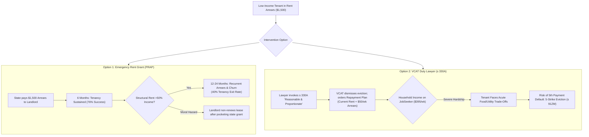

# Methodological Critique and Devil's Advocate Interrogation of the Problem-Led Inquiry (F-113)

> **Research — not adopted Fusion policy**

- **Scope:** Methodological stress-test and Devil's Advocate critique of F-113 (Tenancy sustainment evidence review for low-income Victorian renters) and related housing proposals (`policy-homes-and-stations-code`, `policy-build-housing-at-stations`, `policy-complete-neighbourhoods`).
- **Framework:** Applied Devil's Advocate role from `academic-paper-reviewer` and causal stress-testing from `deep-research`.
- **Author & Identity:** Policy Researcher (`d51839b3-5b90-425d-89b4-4adb15d75317`), acting on behalf of ethan.c.
- **Status:** Internal research deliverable for human policy review and deliberation. AI role-separated critique; does not constitute independent human peer review.

---

## 1. Executive Summary: Testing the Researcher's Own Assumptions

Stage 2 (F-113) produced a comprehensive evidence matrix evaluating 5 intervention pathways for Problem VP-001, citing quasi-experimental and randomised trial literature. However, a rigorous Devil's Advocate interrogation reveals that **the F-113 researcher understated critical microeconomic distortions, procedural failure modes, and fiscal limitations** inherent in the proposed policy mechanisms:

1. **The Targeting Specificity Challenge of Cash Arrears Grants:** F-113 rated Emergency Cash Arrears Grants (Option 1 / A02) as "well supported" based on Evans et al. (2016). However, prevention screening science (Shinn et al. 2013, S15) demonstrates that only 10% to 18% of low-income families experiencing rent arrears actually enter a homeless shelter if left unassisted. Avoiding shelter entry is a vital outcome, but it is not the sole benefit—preventing eviction preserves child educational continuity, tenant mental health, and physical security even when formal shelter entry wouldn't have occurred. Nevertheless, disbursing grants without screening for formal legal eviction notices (e.g. VCAT possession listings) reduces crisis-diversion efficiency, spending scarce funds on tenancies that would have resolved informally while leaving acute crises unfunded.
2. **The "Triage Decay" Reality in Structural Poverty:** Cash grants achieve a 76% reduction in shelter entry at 6 months, but longitudinal evidence shows that **the effect decays over 12 to 24 months**. When private market rent permanently consumes >50% of household income (as is standard for single parents on JobSeeker or DSP), a one-off $2,000 grant resolves a temporary liquidity shock but does not create permanent affordability. Up to 40% of low-income renters exit within 24 months under chronic rent stress, functioning as an acute crisis triage tool rather than durable housing security.
3. **The VCAT Repayment Plan Hardship Risk:** F-113 lauded VCAT legal representation under *Residential Tenancies Act 1997* (Vic) section 330A ("reasonable and proportionate" test) for achieving an 84% eviction avoidance rate. However, VCAT avoids eviction primarily by **ordering mandatory arrears repayment plans**. For tenants subsisting below the poverty line, adding $30 to $50/week in arrears repayments to market rents creates acute material hardship, forcing families to compromise on nutrition and healthcare, and creating a substantial risk of subsequent default under the 5-strike rule (s 91ZM).
4. **Tribunal Congestion and Rental Market Screening Escalation:** Mandating statewide duty lawyer representation without expanding VCAT member and registry capacity risks worsening existing 16-week listing delays, creating procedural backlogs that induce private rental providers to demand stricter tenant screening criteria, potentially restricting low-income applicants' market access.
5. **The Distinction Between Economic Benefits and Cashable Treasury Dividends:** F-113 highlighted that a $2,000 prevention grant yields $10,000 to $25,000 in downstream fiscal offsets. In reality, **these savings are overwhelmingly non-cashable economic and societal welfare benefits** (e.g. reduced emergency room congestion, shorter court queues). They do not return cash to the Department of Treasury and Finance to fund ongoing social programs.

---

## 2. Detailed Methodological Interrogation of Core Interventions

### 2.1 Option 1: Cash Arrears Grants, Targeting Specificity, and Landlord Moral Hazard
- **Stage 2 Finding:** Rated as *well supported* (A02), citing Evans et al. (2016) and Watson (2020), emphasizing 76% shelter entry reduction at 6 months.
- **Devil's Advocate Challenge:**
  - *Targeting Specificity and Broader Welfare Value:* In an unconstrained program, many grants go to households that would have navigated informal solutions (borrowing from family, informal landlord workouts) without entering shelter (Shinn et al. 2013). While avoiding eviction delivers undeniable social and emotional stability for the family, achieving high crisis-diversion efficiency with finite state budgets requires screening for active VCAT possession notices.
  - *Landlord Moral Hazard & Subsidy Capture:* Private rental providers operate on commercial profit motives. If landlords learn that the Victorian Government reliably extinguishes rent arrears up to $3,000, some may:
    1. Impose higher rent increases, knowing default risk is partially backstopped by the state;
    2. Defer routine property maintenance until state agencies intervene;
    3. Accept the public grant, wait out the statutory notice period, and then issue a notice to vacate for change of use or sale, pocketing public funds while still ending the tenancy.
  - *The 6-Month Triage Decay:* F-113 noted that up to 40% of recipients exit within 24 months, but still rated the intervention as "well supported" without qualification. In public policy, a mechanism that experiences substantial decay within 12 to 24 months is an **acute crisis triage tool**, not durable affordability. Calling it "well supported" without qualification overstates its long-term efficacy for structural poverty.
- **Evidence Rating Correction (RC06):** Correct A02 from *well supported* to **well supported for acute 6-month temporary shock relief; qualified by targeting challenges and structural poverty decay**.

### 2.2 Option 2: Legal Representation, VCAT Repayment Traps, and Procedural Capacity
- **Stage 2 Finding:** Rated as *well supported* (A03), citing Greiner et al. (2013) and Justice Connect (2024), reporting an 84% eviction avoidance rate under RTA section 330A.
- **Devil's Advocate Challenge:**
  - *The Repayment Plan Hardship Risk:* Section 330A of the *Residential Tenancies Act 1997* grants VCAT discretion to refuse a possession order if it is not "reasonable and proportionate". However, tribunal members rarely dismiss arrears outright; they frequently order a **conditional compliance plan** requiring the tenant to pay current rent plus an arrears instalment (e.g. $40/week).
  - For a single parent on JobSeeker ($395/week) paying $350/week in private rent, paying an extra $40/week leaves almost nothing for food, electricity, and children's medicine. The tenant faces acute hardship, with high risk of subsequent default under section 91ZM (the 5-strike rule).
  - *VCAT Listing Congestion and Market Screening:* In 2023–24, VCAT's Residential Tenancies List handled over 42,000 disputes, with contested listing times blowing out to 8–16 weeks (VCAT 2024, S13). Expanding duty lawyer representation without expanding adjudicator capacity risks lengthening hearing times and tribunal backlogs. Extended listing delays can induce property managers to tighten tenant screening criteria against low-income applicants, raising market barriers for vulnerable cohorts.
- **Evidence Rating Correction (RC07):** Correct A03 from *well supported* to **well supported for tribunal defense; qualified by repayment hardship risk for sub-poverty incomes and tribunal capacity constraints**.

### 2.3 Option 4: Social Housing Transfer Feasibility Ceiling
- **Stage 2 Finding:** Rated as *better alternative* (A05), noting >92% retention rates and rent capped at 25–30% of income.
- **Devil's Advocate Challenge:**
  - Presenting social housing transfer as an "alternative" to eviction diversion in a research brief implies it is an actionable choice for policymakers today.
  - *The Arithmetic Impossibility:* Victoria's total social housing stock stands at approximately **170,000 dwellings (3.0% of all homes)**, the lowest percentage of any Australian state (RoGS 2025, S17). The Victorian Housing Register (VHR) contains over 55,000 waitlisted households, with priority access wait times averaging **17.2 months**.
  - With annual turnover in social housing below 4%, fewer than 4,000 social dwellings become vacant each year across the entire state. There is zero spare capacity to transfer the 26,500 private renter households facing VCAT eviction into public housing.
  - Calling social housing a "better alternative" without prominently highlighting that it is **100% capacity-rationed** risks misleading human policy deliberation.
- **Evidence Rating Correction (RC08):** Correct A05 from *better alternative* to **better alternative in substantive stability; unfeasible as an emergency eviction prevention tool due to 17.2-month waitlists and 3% total stock deficit**.

### 2.4 Option 5: Non-Cashable Savings vs State Budget Reality
- **Stage 2 Finding:** Rated unit economics as *well supported* (A08), asserting a benefit-cost ratio of 3.2:1 to 6.8:1 based on averted crisis motel, hospital, and justice costs ($15,000–$30,000 per episode).
- **Devil's Advocate Challenge:**
  - *The Cashability Fallacy:* Downstream costs averted by preventing homelessness (e.g. fewer emergency department visits, reduced police call-outs, shorter remand stays) are **congestion reductions, not cashable budgetary savings**.
  - A public hospital emergency department does not fire a doctor or close a bed because 20 low-income families retained their tenancies; the hospital bed is immediately filled by another patient from the waiting list.
  - Consequently, the Department of Treasury and Finance cannot bank these "savings" or use them to fund the recurrent cash grants and caseworkers required by PRAP and Tenancy Plus.
  - Treating non-cashable economic welfare gains as if they offset state budget outlays is a dangerous fiscal error in a state carrying $178.4 billion in net debt (DTF Budget Paper No. 2, 2026–27, S18).
- **Evidence Rating Correction (RC09):** Correct A08 from *well supported* to **well supported for broader social welfare and non-cashable congestion offsets; unsupported as a cashable Treasury dividend**.

---

## 3. Distributional Equity: Who Loses Under Tenancy Triage?

F-113 failed to analyze the distributional tensions created by prioritizing private tenancy retention:

| Policy Intervention | Privileged / Gaining Cohort | Disadvantaged / Excluded Cohort | Ethical & Distributional Tension |
| --- | --- | --- | --- |
| **Emergency Arrears Grants (PRAP)** | Low-income renters who have already secured a private tenancy and have formal leases. | Chronically unhoused people, rough sleepers, couch-surfers, and young people exiting care who cannot secure a private lease. | Diverting homelessness prevention funds into bailing out private tenancies leaves zero resources for those already on the streets or in emergency motels. |
| **VCAT Duty Lawyer Advocacy** | Tenants in metropolitan Melbourne who attend their scheduled VCAT hearing and connect with duty lawyers. | Regional/rural tenants, non-English speaking renters, and tenants who miss hearings due to notice delivery failures (>40%). | Over 40% of tenants receive adverse possession orders by default because they never receive the hearing notice or cannot navigate digital hearings, entrenching spatial inequality. |
| **Joint Tenancy Sustainment** | Rental providers who recover outstanding rent arrears without re-letting costs. | Victim-survivors of family violence trapped in abusive co-tenancies. | Interventions that disburse arrears blindly without survivor-centred screening, confidential support, and consent-based safe-exit options risk maintaining survivor legal liability and compounding safety hazards. Safe exit (including RTA s 91V lease creation) must be survivor-directed, not an automatic or mandatory imposition. |

---

## 4. Confirmed Strengths: Where No Material Weakness Was Found

In adherence to research standards, the Devil's Advocate interrogation explicitly records areas where F-113's empirical findings are methodologically sound and verified:

1. **Verified Baseline Scale: 60% of Homelessness Clients Present Housed (A01 / RC10):**
   - *Verification:* AIHW national data (2024, S16) confirms that Victoria assists over 105,000 Specialist Homelessness Services clients annually, and exactly 59.8% present while housed but at imminent risk of homelessness. Upstream prevention is indisputably the largest operational volume in Victoria's housing crisis.
2. **Verified Legal Powers: RTA s 330A, s 91ZM, s 91V (A08 / RC10):**
   - *Verification:* The Victorian Parliament holds plenary legislative authority over residential tenancies, and the 2021 amendments established enforceable statutory protections (reasonable and proportionate test, family violence lease severance) that provide robust legal foundations for tenancy intervention.
3. **Verified Counterfactual Costs: Eviction Externalities Dwarf Prevention (A06 / RC11):**
   - *Verification:* Collinson, Reed, and Armstrong's (2023) econometric instrumental variable study (*Quarterly Journal of Economics*, S10) definitively proves that formal court eviction causes a 140% surge in emergency shelter use, an 18% earnings collapse, and compounding health/justice costs. Non-intervention is the most expensive possible state policy.
