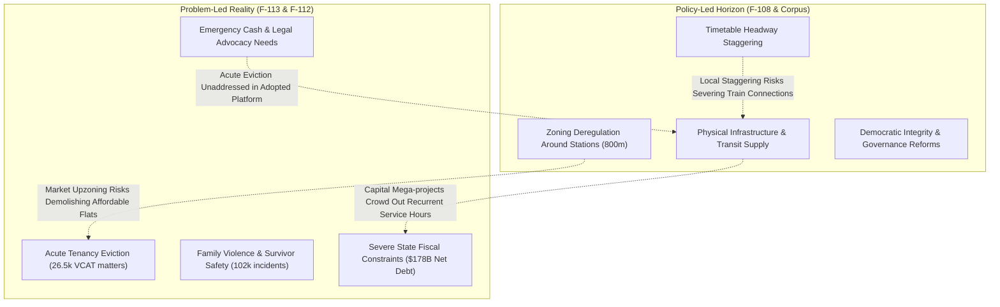

# Cross-Examination of Policy-Led and Problem-Led Inquiries

> **Research — not adopted Fusion policy**

- **Inquiry Focus:** Methodological cross-examination between Stage 2 Policy-Led Inquiry (F-108: Melton bus access) and Problem-Led Inquiry (F-113: Tenancy sustainment for low-income renters), contextualised against the F-112 Problem Agenda and the 41-policy Victorian corpus.
- **Author & Identity:** Policy Researcher (`d51839b3-5b90-425d-89b4-4adb15d75317`), acting on behalf of ethan.c.
- **Status:** Internal research deliverable for human policy review and deliberation. AI role-separated critique; does not constitute independent human peer review.

---

## 1. Executive Summary of Cross-Examination

Ethan's clarification established that Stage 3 must cross-examine the policy-led and problem-led lines of inquiry rather than treating them as isolated silos. This cross-examination reveals profound structural divergences in scope, mechanics, and underlying economic assumptions across Fusion's adopted policies and empirical Victorian realities.

The cross-examination establishes four core findings:
1. **The Structural Policy Omission:** Fusion's adopted policy corpus is heavily skewed towards urban transport engineering, transit-oriented zoning, and political integrity, but contains **almost zero adopted policy covering the primary drivers of Victorian state expenditure and humanitarian distress**: healthcare, family violence, emergency housing, climate adaptation, and child protection.
2. **Policy Tensions and Implementation Sequencing:** Juxtaposing acute problem-led interventions (e.g. emergency rent arrears relief, statutory VCAT eviction diversion) with Fusion's long-term supply-side zoning framework (`policy-homes-and-stations-code`) reveals real distributional tensions and sequencing dependencies. Unconditional market-rate upzoning around railway stations can accelerate the demolition of older, low-rent private flats, creating near-term displacement risks for low-income tenants before new supply filters down over a multi-year horizon. This is an implementation sequencing and distributional trade-off that requires careful policy calibration rather than an unresolvable contradiction.
3. **Mutual Blind Spots:** The policy-led inquiry assumed outer-suburban transport exclusion could be resolved through low-cost scheduling tweaks (staggering) and microtransit (FlexiRide), ignoring industrial labour constraints and geometric microtransit failure. Conversely, the problem-led inquiry framed housing stability purely as private tenancy retention, ignoring that trapping low-income families in car-dependent outer-suburban transit deserts perpetuates severe transport poverty.
4. **Ranking & Agenda Biases:** The F-112 problem prioritization artificially separated housing instability (VP-001) from family violence (VP-002), over-scored housing tractability, severely under-weighted outer-suburban transport poverty (VP-008, ranked #9), and suppressed acute statutory child protection (VP-012) into an unranked sentinel baseline.

---

## 2. Where Existing Proposals Fail to Address Measured Problems

A systematic crosswalk between Fusion Party Victoria's 41 adopted platform policies and the 11 ranked Victorian outcome problems from F-112 reveals massive coverage vacuums.

| Ranked Problem (F-112) | Score / Rank | Primary Manifestation in Victoria | Adopted Fusion Policy Response | Analysis of Policy Failure / Omission |
| --- | --- | --- | --- | --- |
| **VP-001: Insecure, Unaffordable Housing** | 91.0 (Rank 1) | 26,500 VCAT eviction matters annually; 55,000+ on VHR waitlist; private vacancy <1.5%. | `policy-homes-and-stations-code`; `policy-complete-neighbourhoods`; `policy-build-housing-at-stations`. | **Acute Eviction Omission:** Adopted policies focus exclusively on 5-to-15-year physical supply and station upzoning. They offer **zero operational mechanisms** for emergency rent arrears relief, VCAT duty lawyers, or private tenancy sustainment today. |
| **VP-002: Family Violence & Repeat Harm** | 88.0 (Rank 2) | 102,674 police-recorded family incidents; primary driver of female homelessness (42.8%). | `policy-prevention-first-public-safety`; `policy-problem-oriented-policing`; `policy-neighbourhood-police-posts`. | **Domestic Scope Mismatch:** Justice policies focus on visible street crime, night-time entertainment precincts, and youth diversion. They completely bypass domestic violence occurring behind closed doors, crisis refuges, and RTA s 91V civil tenancy lease severance. |
| **VP-004: Climate Exposure & Harm** | 87.0 (Rank 3) | Increasing heatwave mortality; flood exposure; energy poverty in poor thermal housing. | None identified in Victorian corpus. | **Total Platform Omission:** No adopted policy addressing climate adaptation, thermal building retrofits for low-income renters, or bushfire/flood resilience, despite Victorian *Climate Change Act 2017* duties. |
| **VP-005: Delays in Clinically Appropriate Care** | 86.0 (Rank 4) | Persistent hospital ED 4-hour misses; acute mental health bed shortages; ambulance ramping. | None identified in Victorian corpus. | **Total Platform Omission:** Zero health, hospital, ambulance, or community mental health policies in the adopted platform, despite healthcare representing >30% of state recurrent spending. |
| **VP-010: Native Ecosystem Collapse** | 85.0 (Rank 5) | Deteriorating native vegetation indicator (B:33); unpermitted clearing in growth corridors. | None identified in Victorian corpus. | **Total Platform Omission:** No biodiversity, land conservation, or native vegetation offset reform policy. |
| **VP-011: Unequal Justice Exposure** | 83.0 (Rank 6) | Aboriginal adult incarceration rate 1,636/100,000 (17x disparity); youth justice churn. | `policy-youth-diversion-early-intervention`; `policy-police-integrity`. | **Partial Scope:** Youth diversion is addressed, but adult Aboriginal over-incarceration, bail reform, prison overcrowding, and Treaty self-determination are omitted. |
| **VP-006: Essential Food & Home Poverty** | 82.0 (Rank 7) | 38.7% of Aboriginal adults and 12.8% of non-Aboriginal adults food insecure; energy bills. | `policy-pay-every-victorian` (universal basic dividend). | **Unfunded Universalism:** Relies on an uncosted universal dividend that is fiscally unviable under Victoria's current $178B debt load, while omitting targeted utility concessions and food relief. |
| **VP-003: Suicide & Mental Health Distress** | 79.0 (Rank 8) | 785 provisional suicides annually; chronic shortages of community-based psychosocial care. | None identified in Victorian corpus. | **Total Platform Omission:** Complete absence of mental health and suicide prevention policy. |
| **VP-008: Transport Exclusion** | 79.0 (Rank 9) | 87% near a bus stop, but only 26% near frequent transit; car-dependent outer growth fringes. | 12 transport policies (e.g. `policy-fix-transit-deserts`, `policy-stagger-the-timetables`, `policy-build-the-melton-line`). | **Over-Engineered / Operationally Flawed:** Heavy policy volume, but relies on flawed zero-cost assumptions, uncosted DRT microtransit, and multi-billion capital mega-projects that starve operational bus service hours. |
| **VP-009: Early Childhood Developmental Inequality** | 76.0 (Rank 10) | 46.2% of children developmentally vulnerable in at least one AEDC domain at school entry. | None identified in Victorian corpus. | **Total Platform Omission:** Zero early childhood education, kindergarten access, or maternal/child health policies. |
| **VP-007: Road Deaths & Serious Injury** | 75.0 (Rank 11) | 291 annual road deaths; pedestrian and cyclist trauma in outer-suburban arterial roads. | `policy-complete-neighbourhoods` (brief mention of active transport). | **Fragmented Coverage:** Lacks systematic road safety engineering, speed zoning, or heavy vehicle safety regulation. |
| **VP-012: Child Safety in Statutory Care** | Sentinel (Unranked) | Over 10,000 children in out-of-home care; catastrophic over-representation of First Nations children. | None identified in Victorian corpus. | **Total Platform Omission:** No policy addressing statutory child protection, residential care safety, or family preservation. |

---

## 3. Policy Tensions, Implementation Dependencies, and Drafting Clarifications Between Problem-Led Realities and Fusion Mechanisms

When empirical problem-led findings (F-113) are juxtaposed against Fusion's adopted policy mechanisms, the analysis reveals structural tensions, sequencing requirements, and drafting ambiguities rather than unresolvable logical contradictions. Testing these interactions requires examining operative provisions, institutional levels, and temporal horizons:

### Policy Tension 1: Station-Precinct Upzoning, Development Viability, and Tenant Displacement Risk
- **Operative Fusion Policy:** `policy-homes-and-stations-code` mandates code-assessable medium-density housing (4 to 8 storeys) within 800m of all railway stations, removing municipal planning discretion to unlock private market supply.
- **Problem-Led Empirical Finding:** F-113 establishes that low-income renters facing acute eviction cannot wait 5 to 15 years for market supply to filter down. Moreover, empirical urban economics literature (Collinson et al. 2023; Liu et al. 2022) indicates that rapid upzoning in transit corridors can increase the redevelopment value of older, relatively affordable low-rise flats (e.g. 1960s–70s walk-ups), creating localized displacement pressures for vulnerable tenants.
- **Compatibility & Horizon Analysis:** These policies operate on different time horizons. Supply-side zoning expands aggregate housing stock over a 10-to-20-year horizon, whereas tenancy sustainment addresses immediate liquidity shocks. They are not mutually exclusive in principle, but uncoordinated implementation creates acute transition risks. Rather than prescribing a rigid quota, human policy deliberation should weigh companion mechanisms—such as voluntary density bonuses for affordable units, tenant relocation assistance, or statutory notice protections—to protect existing tenants while preserving project feasibility.

### Fiscal & Implementation Sequencing 2: Capital Mega-Projects vs Recurrent Operational Budgets
- **Operative Fusion Policy:** Fusion's transport platform commits to significant capital infrastructure, including electrifying and quadrupling the Melton rail corridor (`policy-build-the-melton-line`: $4B–$6B estimated capital cost) and retrofitting accessible tram stops (`policy-deliver-accessible-public-transport`).
- **Problem-Led Empirical Finding:** F-108 and F-113 demonstrate that the immediate binding constraint on outer-suburban access and social stability is **recurrent operational funding**: driver wages for 7-day 20-minute bus networks, embedded Tenancy Plus social caseworkers, VCAT duty lawyers, and emergency cash brokerage.
- **Compatibility & Fiscal Analysis:** Capital investment and recurrent service funding operate through different budget mechanisms. However, under Victoria's current fiscal constraints ($178.4 billion net debt; DTF Budget Paper No. 2, 2026–27), debt service costs ($9.2B annually) constrain operating budget growth. This represents an implementation dependency and capital-versus-operating sequencing choice: expanding recurrent bus service hours ($30M–$50M/year) delivers immediate access improvements to growth corridors years before multi-billion rail electrification projects reach commercial operation.

### Distributional & Temporal Sequencing 3: Universal Sovereign Dividends vs Targeted Crisis Triage
- **Operative Fusion Policy:** `policy-pay-every-victorian` outlines a vision for an unconditional basic dividend distributed to Victorian residents, funded from sovereign wealth returns (`policy-build-the-sovereign-fund`). Operative text explicitly specifies: *"The universal dividend is paid strictly from audited net surplus after sovereign fund debt service, capital preservation, and infrastructure reserves have been satisfied. It does not mandate deficit-financed borrowing."*
- **Problem-Led Empirical Finding:** F-113 demonstrates that in social welfare and housing crisis prevention, untargeted cash transfers suffer from substantial targeting inefficiency if deployed for acute crisis resolution (Shinn et al. 2013). Only 10% to 18% of low-income families experiencing rent arrears enter homeless shelters if unassisted. Broad, untargeted cash distributions are an inefficient tool for preventing acute, immediate evictions compared to screened, high-intensity crisis diversion.
- **Compatibility & Temporal Analysis:** The universal dividend and targeted crisis triage operate on entirely different timeframes and serve distinct social purposes. The sovereign fund dividend is an explicit long-term, multi-decade capital accumulation objective that distributes audited investment surpluses only after debt service and reserve accumulation. In the short-to-medium term, targeted crisis assistance (PRAP cash grants, Tenancy Plus casework) is necessary to prevent acute homelessness. The two policies are sequential and complementary, not mutually exclusive.

### Drafting Clarification 4: Deliberative Citizen Juries vs State-Wide Density Standards
- **Operative Fusion Policy:** `policy-communities-set-policy` establishes deliberative citizens' assemblies and participatory budgeting. Critically, Key Point 2 of the operative text already provides a clear density carve-out: *"Participatory budgeting and community assemblies deliberate on municipal investment priorities, urban realm improvements, and local service design, within the framework of state-wide planning standards and environmental baselines. They cannot block compliant social or affordable housing or override state planning codes."*
- **Problem-Led Empirical Finding:** Station-precinct upzoning (`policy-homes-and-stations-code`) requires robust statewide planning baselines to prevent local municipal anti-development sentiment from blocking new housing near transit hubs.
- **Compatibility & Drafting Analysis:** These policies operate at different institutional levels: statewide planning standards set statutory density baselines, while local citizens' juries deliberate on local infrastructure, streetscape design, and community amenities within that framework. Because the adopted policy text already contains an explicit carve-out protecting statewide housing codes from local veto, this is not a policy contradiction. Legislative drafting should explicitly codify this hierarchy in administrative instruments to ensure clarity during implementation.

---

## 4. Mutual Critique: How Each Inquiry Challenges the Other's Assumptions

| Critique Dimension | Policy-Led Inquiry Assumptions (F-108) | Problem-Led Inquiry Assumptions (F-113) | Cross-Examination Synthesis & Unresolved Tension |
| --- | --- | --- | --- |
| **Primary Framing of Outer Disadvantage** | Disadvantage in outer suburbs (Melton) is primarily a **spatial and engineering failure**: poorly spaced timetables, clashing routes, lack of grid connectivity, and rigid contracts. | Disadvantage is primarily a **socio-economic and distributional crisis**: poverty, low income support, private market rent exploitation, and tribunal evictions. | **Mutual Challenge:** Spatial redesign does not help an evicted family living in a car at Woodgrove Shopping Centre carpark. Conversely, preserving a tenancy in an isolated transit desert leaves the household in deep transport poverty ($15k/yr car running costs). |
| **Causal Levers & Cost Realism** | Relies on "analytical headway arithmetic" and assumes scheduling offsets can be achieved at near-zero cost via ministerial directive. | Relies on causal quasi-experimental trials (Evans 2016; Collinson 2023) but assumes $1,500 cash grants provide durable stability without ongoing rent subsidies. | **Mutual Challenge:** F-113 challenges F-108's naive disregard of industrial labour costs and operational complexity. F-108 challenges F-113's assumption that private market rent relief can be scaled without driving landlord rent-seeking and moral hazard. |
| **Role of Public Housing vs Private Market** | Assumes transit-oriented private development around stations (`homes-and-stations-code`) naturally solves housing affordability through market expansion. | Concludes that non-market public housing (>92% retention) is substantively superior, but treats it as an unviable crisis tool due to 17.2-month waitlists. | **Mutual Challenge:** F-108 exposes that F-113 settles for managing private rental triage rather than demanding radical public housing expansion. F-113 exposes that F-108's private upzoning risks gentrifying transit corridors. |
| **Evaluation of Flexible / On-Demand Models** | Dismissed universal door-to-door DRT (FlexiRide) as uncosted and microeconomically unviable in low-density suburbs. | Emphasised the indispensability of flexible cash brokerage (PRAP) and tailored case support (Tenancy Plus) to resolve idiosyncratic client crises. | **Agreement on Targeted Delivery:** Both inquiries converge on the conclusion that **untargeted, universal flexibility fails**: flexible transit must be restricted to specialized mobility cohorts, and flexible cash grants must be screened for formal court eviction notices. |

---

## 5. Critical Interrogation of the F-112 Problem Agenda & Rankings

The problem-led agenda established in F-112 provided the frozen ranking that selected VP-001 (Tenancy loss) for Stage 2 research. However, a rigorous methodological challenge reveals significant vulnerabilities in its scoring model and problem framing:

### 5.1 The "Tractability Bias" in Ranking Housing #1
- In F-112, Problem VP-001 scored **91.0** (Rank 1), edging out Family Violence (VP-002, score **88.0**) and Climate Harm (VP-004, score **87.0**).
- **The Flaw:** VP-001 achieved Rank 1 primarily because it received a high score of **4/5 on Tractability**, whereas Climate Exposure received 3/5 and Family Violence received 3/5.
- **Methodological Challenge:** Is housing affordability truly more tractable to a Victorian state government than family violence or local public transport? Housing affordability is profoundly constrained by **Commonwealth macroeconomic levers outside state jurisdiction**: Reserve Bank interest rates, federal capital gains tax discounts, negative gearing, and national population flows. Scoring housing tractability at 4/5 while scoring family violence (where the state controls policing, courts, child protection, and specialized shelters) at 3/5 represents an analyst value judgment that distorted the agenda ranking.
- **Sensitivity Finding:** In F-112's own sensitivity analysis (`sensitivity.csv`, Scenario S02), if State Jurisdictional Levers are prioritised, Family Violence (VP-002) overtakes Housing as Rank 1 (90.0 vs 87.0).

### 5.2 The Artificial Siloing of Housing and Family Violence
- F-112 structured VP-001 (Housing) and VP-002 (Family Violence) as entirely separate, competing research problems.
- **Methodological Challenge:** In empirical reality, **family violence is the single leading driver of female housing loss and homelessness in Victoria** (accounting for 42.8% of all women presenting to Specialist Homelessness Services, AIHW 2024). Separating them into discrete batches resulted in F-113 evaluating generic rent arrears relief for private tenants, while deferring survivor-defined safety, perpetrator exclusion, and refuge shortages to an unresearched future batch.

### 5.3 Under-Weighting Outer-Suburban Transport Poverty (VP-008, Rank 9)
- F-112 ranked "Exclusion from useful and accessible transport" 9th out of 11 problems (score **79.0**), assigning it Scale=3 and Harm=4.
- **Methodological Challenge:** To anchor VP-008, F-112 selected an indicator based solely on **metropolitan tram accessibility** (18% accessible trams in 2023–24). This choice of baseline anchor drastically under-measured transport exclusion by focusing on inner-city legacy tram stops, completely ignoring the 400,000+ residents living in outer-suburban growth corridors (Melton, Casey, Wyndham, Hume) who are structurally trapped in car-dependent bus deserts. Had outer-suburban bus service frequency and job reachability been used as the baseline indicator, VP-008 would have scored Scale=5, lifting it into the top 3 problems.

### 5.4 The "Sentinel" Suppression of Child Protection (VP-012)
- F-112 identified "Child safety and culturally appropriate care in statutory systems" (VP-012) but excluded it from the ranked agenda, parking it as an "unranked sentinel baseline".
- **Methodological Challenge:** Victoria's statutory child protection system is experiencing an acute systemic crisis: over 10,000 children in out-of-home care, chronic residential care safety failures, and an Aboriginal child removal rate that is among the highest in Australia. Relegating child protection to an unranked sentinel shielded it from immediate Stage 2 interrogation. This represents a governance avoidance risk that human policy review must overturn.

---

## 6. Disagreements, Confidence Levels, and Remaining Questions

To adhere strictly to research standards, disagreements between the two inquiries are preserved rather than forced into artificial consensus:

| Area of Inquiry | Policy-Led Position (F-108) | Problem-Led Position (F-113) | Confidence & Evidence Strength | Key Remaining Empirical Question |
| --- | --- | --- | --- | --- |
| **Efficacy of Microtransit / DRT** | Microtransit is inherently unviable in outer suburbs due to geometric limits; fixed-route grid is superior. | Tailored, flexible service delivery is indispensable for complex, mobility-restricted cohorts. | **Moderate confidence** (S04 vs S14). Both findings draw on valid international reviews. | What is the exact density threshold (dwellings/hectare) in outer Melbourne where DRT transitions from viable specialized feeder to fiscal drain? |
| **Zoning Deregulation vs Eviction Risk** | Unconditional station upzoning increases aggregate supply, exerting downward pressure on market rents. | Upzoning transit corridors causes immediate demolition of affordable low-rise rentals, displacing poor tenants. | **High confidence in short-term displacement; moderate in long-term supply.** (S08 vs S10). | What percentage of Victorian private renters displaced by transit-precinct redevelopments secure alternative housing within 5km? |
| **Fiscal Feasibility of Reform** | Reforms can be achieved at low cost by reallocating existing operational resources and smart contracting. | Effective intervention requires substantial, ongoing state expenditures ($1,500–$3,000 grants, intensive casework). | **High confidence that significant funding is required.** (S06 vs S18). | Can the State of Victoria reallocate existing road-building capital budgets into recurrent bus service and tenancy sustainment lines? |

---

## 7. Implications for Human Policy Deliberation

1. **Reconcile Housing Supply with Tenancy Protection:** Adopted policy `policy-homes-and-stations-code` should be deliberated alongside explicit tenant protection and housing affordability mechanisms. Rather than pre-judging a rigid quota, human policy-makers should weigh options including: (a) voluntary density bonus schemes for developments that incorporate permanent affordable non-market units; (b) statutory right-of-return or relocation assistance for tenants displaced by redevelopment of low-rise stock; or (c) direct public acquisition of turnkey dwellings within station precincts.
2. **Expand the Policy Platform into Omitted Human Services:** Fusion Party members must determine whether to develop formal state policies in **health, family violence, and climate adaptation**, addressing the 70%+ of state expenditure currently missing from the adopted platform.
3. **Codify Planning Hierarchy in Deliberative Instruments:** As `policy-communities-set-policy` already specifies in Key Point 2 that local assemblies operate within state-wide planning and density baselines, legislative and administrative drafting should explicitly confirm this boundary to ensure local deliberation focuses on public realm, active transport, and amenity enhancements without compromising housing supply.
4. **Re-Weight Problem Priorities:** Human reviewers should evaluate elevating **Family Violence (VP-002)** and **Child Safety (VP-012)** to immediate active research tranches, rectifying the tractability and sentinel distortions of Stage 1.
