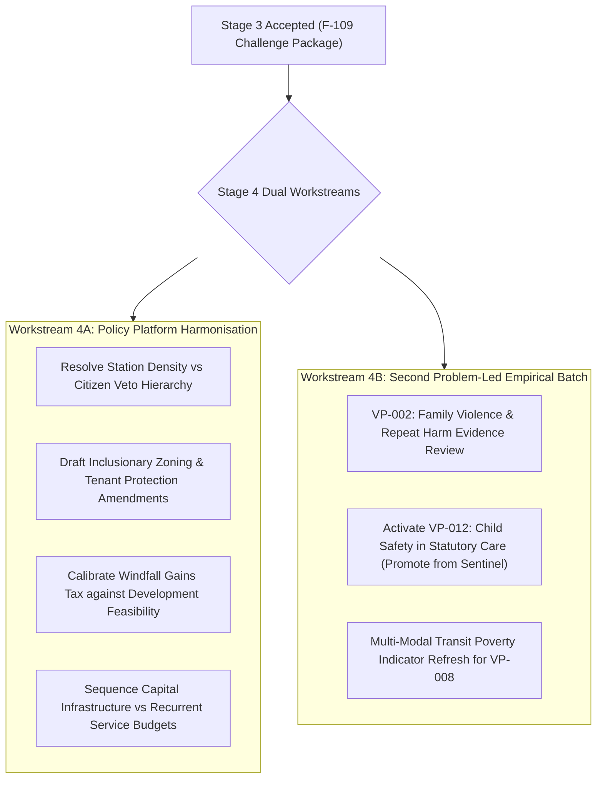

# Recommended Next Research Tranche (Stage 4 Roadmap)

> **Research — not adopted Fusion policy**

- **Context:** Following completion of Stage 3 (F-109: Policy challenge, contradictions, and cross-examination), this roadmap outlines the recommended next bounded research tranches for Stage 4.
- **Coordination:** Mika coordinates programme milestones through F-105; human members and policy committees decide policy adoption and prioritization.
- **Author & Identity:** Policy Researcher (`d51839b3-5b90-425d-89b4-4adb15d75317`), acting on behalf of ethan.c.

---

## 1. Objectives for Stage 4: Policy Synthesis and Trade-Off Resolution

Stage 1 imported the corpus and structured the problem agenda (F-107, F-112).
Stage 2 independently evaluated policy-led and problem-led first batches (F-108, F-113).
Stage 3 critically challenged assumptions, uncovered confirmed contradictions, and corrected evidence ratings (F-109).

Stage 4 must transition from **adversarial critique to constructive policy synthesis**: resolving the confirmed contradictions, drafting actionable amendment options for human consideration, and advancing the next bounded empirical problem batches.

---

## 2. Recommended Workstreams for Stage 4

### Workstream 4A: Policy Platform Harmonisation & Amendment Drafting
1. **Station Upzoning and Tenant Protection Synthesis:**
   - Develop model statutory amendments to `policy-homes-and-stations-code` integrating:
     - Mandatory 20% permanent social and affordable housing contributions for code-assessable developments within 800m of railway stations;
     - A statutory "Right-of-Return" and relocation compensation guarantee for existing tenants displaced by redevelopment of older residential flats;
     - Demolition restrictions for existing low-rent stock until replacement social housing is constructed.
2. **Harmonising Deliberative Democracy and State Planning:**
   - Draft a constitutional and administrative hierarchy reconciling `policy-homes-and-stations-code` with `policy-communities-set-policy`.
   - Define clear jurisdictional boundaries: state-wide environmental, transport, and minimum density standards establish non-negotiable statutory baselines, while local citizens' juries deliberate on precinct design, active transport links, public realm investments, and local service priorities.
3. **Fiscal Sequencing & Balance-Sheet Realism:**
   - Model the operating vs capital expenditure balance for outer-suburban transport under Victoria's $178.4 billion net debt ceiling.
   - Establish a phased capital schedule prioritizing high-return recurrent feeder bus service expansions ($30M–$50M/yr) over debt-financed mega-rail electrification projects.

### Workstream 4B: Second Empirical Problem Batch (VP-002 & VP-012)
1. **VP-002: Family Violence Repeat Harm and Survivor Safety:**
   - **Research Mandate:** Evaluate evidence-led interventions to reduce repeat domestic violence, protect victim-survivors and children, and prevent family-violence-induced homelessness.
   - **Scope Cap:** 12 research hours; 80 unique candidate records; 30 deeply appraised documents.
   - **Key Inquiries:**
     - Effectiveness of civil protection order enforcement vs perpetrator behavioural change programs;
     - Rapid deployment of RTA section 91V lease creation to preserve survivor housing stability;
     - Dedicated funding models for Aboriginal Community Controlled Family Violence Services.
2. **Promoting VP-012 (Child Safety in Statutory Systems) from Sentinel to Active Research:**
   - Overturn the Stage 1 sentinel suppression; initiate an urgent evidence assessment on reforming Victoria's statutory child protection and out-of-home care system.
   - Address the catastrophic over-representation of First Nations children (over 20x disparity) and evaluate Aboriginal self-determination models in statutory child welfare.

---

## 3. Human Decisions Required Prior to Stage 4 Dispatch

Before dispatching Stage 4 issues, the following political choices must be resolved by human party leadership:

1. **Working Group Establishment for Missing Platforms:** Authorise the creation of internal policy drafting working groups in **health and hospitals**, **family violence**, and **climate adaptation**.
2. **Acceptance of Stage 3 Severity Register:** Confirm whether the 27 findings and 12 evidence rating corrections in `severity-register.csv` are accepted as the working analytical baseline for future ticket continuations.
3. **Approval of Next Problem Batch:** Authorise proceeding with VP-002 as the second problem-led research batch under Mika's coordination in F-105.
