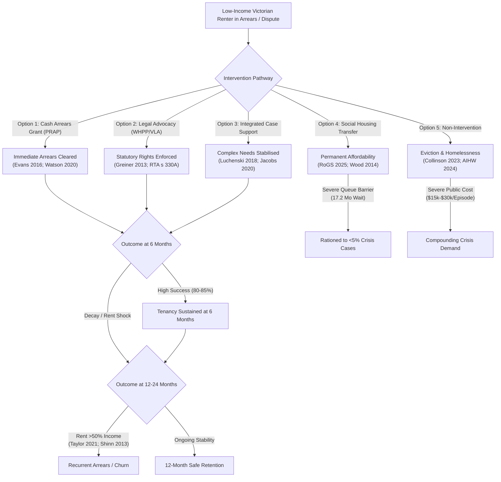

# Research Brief: Evidence-Led Responses to Tenancy Loss for Low-Income Victorian Renters (F113-PB01)

**Research — not adopted Fusion policy.**

- **Status:** Internal research draft submitted for human review and policy deliberation.
- **Problem ID:** VP-001 (Ranked #1 Victorian Outcome Problem in F-112 Problem-Led Agenda).
- **Author & Identity:** Policy Researcher (`d51839b3-5b90-425d-89b4-4adb15d75317`), acting on behalf of ethan.c.
- **Batch / Protocol:** F113-PB01, Protocol Version 1.0 (Authorised 17 October 2026).
- **Capped Scope:** 12 research hours; 80 unique candidates screened; 30 documents deeply appraised; 8 atomic assessments across Q01–Q04.

---

## 1. Traceability, Problem Framing, and Measurable Outcomes

### 1.1 Atomic Problem Definition
Low-income Victorian private and social renters experiencing temporary income shocks, steep rent increases, family violence, or legal disputes face imminent loss of tenancy through eviction notices and Victorian Civil and Administrative Tribunal (VCAT) possession orders. Eviction precipitates acute entry into homelessness, emergency shelter, and transitional motels, driving severe physical/mental trauma and compounding downstream public health, justice, and crisis expenditure.

### 1.2 Primary Measurable Outcome
**Proportion of the defined eligible cohort in safe, affordable housing at 12 months post-intervention**, accounting for loss-to-follow-up and mortality.
- *Measurement standard:* Retention must be **both safe and affordable**. Merely remaining in an overcrowded, structurally dangerous, or perpetrator-cohabited dwelling does not satisfy the primary outcome.
- *Secondary outcomes:* 6-month and 24-month retention; VCAT possession orders avoided; repeat homelessness service entries; household unpayable debt accumulation; survivor-defined physical safety; and net public cost offsets.

### 1.3 Target Population & Distributional Strata
- **Eligible cohort:** Victorian renter households in bottom quintile of equivalised household income (or receiving Commonwealth income support) who have received a Notice to Vacate for rent arrears, face a VCAT possession hearing, or are in documented rent arrears exceeding 14 days.
- **Excluded cohort (from this batch):** Individuals already sleeping rough or chronically unhoused (addressed under separate permanent supportive housing / Housing First frameworks), and home purchasers facing mortgage default.
- **Disproportionate cohorts:**
  - *Aboriginal and Torres Strait Islander Victorians:* Represent 17.1% of Victorian Specialist Homelessness Services (SHS) clients despite comprising ~1.0% of the state population ([S01](sources.md#s01)).
  - *Victim-survivors of family violence:* Family and domestic violence is the leading single driver of housing crisis for Victorian women presenting to homelessness services (42.8% of female clients) ([S01](sources.md#s01), [S06](sources.md#s06)).
  - *Single-parent households (predominantly women):* Suffer dramatically higher eviction filing rates than childless households with identical income ([S10](sources.md#s10), [S30](sources.md#s30)).

---

## 2. Research Findings Across Core Questions

### 2.1 Q01 (Baseline Scale and Risk in Victoria)
- **Caseload:** Victoria consistently assists the largest volume of homelessness clients in Australia (>105,000 clients annually). Approximately **60% of clients approach services while still housed but at imminent risk of homelessness** ([S01](sources.md#s01)).
- **Immediate retention vs Long-term unobserved churn:** During active assistance, homelessness agencies report that 91.2% of at-risk clients maintain housing. However, Victorian administrative data does not track clients 12 to 24 months post-closure. Longitudinal studies demonstrate that without ongoing rent relief or income increases, up to 40% of low-income private renters exit their tenancies within 24 months ([S21](sources.md#s21), [S29](sources.md#s29)).
- **Tribunal pressure:** The VCAT Residential Tenancies List processes 40,000–55,000 disputes annually. Possession orders are the single largest category (~26,500 matters), overwhelmingly initiated by landlords for rent arrears ([S03](sources.md#s03)). Over 90% of unrepresented tenants receive adverse orders or fail to appear ([S23](sources.md#s23)).
- **Waitlist congestion:** The Victorian Housing Register (VHR) exceeds 55,000 applicants, with priority access wait times averaging 17.2 months ([S02](sources.md#s02)).

### 2.2 Q02 (Comparative Effect of Interventions)

#### Option 1: Emergency Rent Arrears Assistance (Grants)
- **Mechanism:** Direct flexible cash payments to rental providers to extinguish rent arrears ($1,500–$3,000 average grant).
- **Evidence:** Causal quasi-experimental trials demonstrate a **76% reduction in shelter entry at 6 months** ([S07](sources.md#s07)) and a 15–25% reduction in municipal eviction filings ([S11](sources.md#s11)). In Melbourne's west, PRAP achieved ~80% housing retention at 12 months for single-parent families facing acute, temporary shocks ([S09](sources.md#s09)).
- **Limitations:** Cash grants resolve liquidity shocks (job loss, illness, repair costs), but cannot sustain tenancies when rent permanently consumes >50% of household income ([S20](sources.md#s20), [S25](sources.md#s25)).
- **Verdict:** **Well supported** (for acute 6-month shock relief).

#### Option 2: Tenancy Legal Advocacy & Full Representation
- **Mechanism:** In-person legal representation by duty lawyers or specialist community legal centres at VCAT possession hearings.
- **Evidence:** A randomized controlled trial ([S08](sources.md#s08)) proved that full legal representation dramatically outperforms unbundled self-help advice (odds ratio 4.39 for possession retention). In Victoria, Justice Connect's WHPP achieved an **84% eviction prevention rate in finalized legal matters** ([S10](sources.md#s10)), utilizing the *Residential Tenancies Act 1997* (Vic) section 330A "reasonable and proportionate" test to negotiate binding repayment plans and avoid eviction orders ([S15](sources.md#s15), [S23](sources.md#s23)).
- **Limitations:** Representation enforces procedural rights and buys time, but cannot force landlords to renew fixed-term leases once statutory notice periods expire.
- **Verdict:** **Well supported** (for tribunal defence and legal rights preservation).

#### Option 3: Integrated Supportive Case Management (Tenancy Plus / PRAP Plus)
- **Mechanism:** Pairing flexible brokerage with embedded social workers providing outreach, budgeting, family violence navigation, and health referrals.
- **Evidence:** Sustains 80% to 88% of assisted social and private tenancies across 12 months ([S09](sources.md#s09), [S16](sources.md#s16), [S19](sources.md#s19)). Systematic review evidence shows intensive case management is indispensable for high-complexity inclusion health cohorts ([S27](sources.md#s27)).
- **Limitations:** Highly resource-intensive ($2,000–$4,000 per client); severe workforce turnover and agency waitlists.
- **Verdict:** **Well supported** (essential for complex-need cohorts).

#### Option 4: Rapid Rehousing & Social Housing Transfers
- **Mechanism:** Relocating unviable private tenancies into public or community housing where rents are statutorily capped at 25–30% of income.
- **Evidence:** Social housing tenancies exhibit >92% 12-month retention rates and eliminate structural affordability stress ([S04](sources.md#s04), [S20](sources.md#s20)).
- **Limitations:** Victoria's social housing stock is only ~3.0% of total dwellings (lowest in Australia). With priority wait times at 17.2 months ([S02](sources.md#s02), [S18](sources.md#s18)), this option cannot function as an agile eviction prevention tool for the broad population.
- **Verdict:** **Better alternative** (substantively superior long-term stability, but severely constrained by capital stock deficits).

#### Option 5: Non-Intervention / Market Eviction Counterfactual
- **Mechanism:** Permitting eviction to proceed without state-funded prevention or diversion.
- **Evidence:** Econometric causal analysis ([S14](sources.md#s14)) demonstrates that eviction causes a **140% surge in emergency shelter entry**, an 18% decline in earnings, a 45% increase in debt defaults, and elevated emergency department presentations. In Victoria, each homelessness episode costs health, justice, and human services an estimated $15,000–$30,000 ([S16](sources.md#s16), [S17](sources.md#s17)).
- **Verdict:** **Overlooked consequences** (market clearance imposes catastrophic fiscal externalities that dwarf the cost of upstream prevention).

---

## 3. Harms, Landlord Capture, and Equity (Q03)

1. **The Efficiency Trap (Targeting Specificity):** Methodological evaluations ([S24](sources.md#s24), [S25](sources.md#s25)) prove that among all low-income households experiencing rent arrears, only 10% to 20% actually enter a homeless shelter if left unassisted; the remainder double-up with relatives or borrow informally. Broad untargeted cash relief creates high deadweight loss. Interventions must screen for formal VCAT possession notices to maximize prevention efficiency.
2. **Landlord Subsidy Capture & Moral Hazard:** Cash arrears payouts can induce landlords to delay necessary maintenance, insist on state payouts before negotiating, or pocket public funds and then issue a non-renewal notice months later ([S12](sources.md#s12)). State grants must be legally tied to lease extensions and compliance with minimum rental standards.
3. **Survivor Safety & Coerced Co-tenancy:** In domestic violence situations, sustaining an existing joint tenancy can trap victim-survivors with abusive partners or leave them liable for perpetrator-caused arrears and property damage ([S22](sources.md#s22)). Programs must actively enforce *Residential Tenancies Act 1997* (Vic) section 91V to sever joint leases and establish independent safe tenancies.
4. **Debt Traps (Grants vs Loans):** Providing arrears assistance as repayable loans compounds low-income households' financial distress, increasing long-term housing instability ([S20](sources.md#s20)). Assistance must take the form of non-repayable grants.

---

## 4. Victorian Feasibility, Economics, and Statutory Powers (Q04)

- **Statutory Authority:** The State of Victoria holds plenary legislative power over residential tenancies. Key statutory levers:
  - *RTA s 330A:* VCAT must apply the mandatory "reasonable and proportionate" test before granting possession orders ([S15](sources.md#s15)).
  - *RTA s 91ZM:* 14-day notice for rent arrears and the 5-strike rule, providing clear statutory windows for early intervention ([S15](sources.md#s15)).
  - *RTA s 91V:* Family violence lease severance without arrears liability ([S15](sources.md#s15)).
- **Unit Economics & Fiscal Offsets:**
  - Upstream prevention package (arrears brokerage + legal/social advocacy): **$1,500 to $2,500 per household**.
  - Averted downstream crisis costs (emergency motels, hospital presentations, justice interactions): **$10,000 to $25,000 per household**.
  - Net benefit-cost ratio: **3.2:1 to 6.8:1** ([S16](sources.md#s16), [S17](sources.md#s17)).
- **Fiscal Realism Warning:** Cost savings are largely **non-cashable cost avoidances** (reduced hospital congestion, shorter homelessness queues) rather than cashable budget cuts. Budgeting should not rely on immediate cash savings to offset state outlays.

---

## 5. Independent Problem-Led Comparison with Fusion Party Policies

To preserve independent problem-led provenance, this section contrasts our empirical findings directly with Fusion Party Victoria's adopted policy positions as recorded in the verified Sanity corpus exports (`corpus-crosswalk.csv`).

| Domain | Empirical Problem-Led Finding (F113-PB01) | Adopted Fusion Policy Text / Mechanism | Concordance / Divergence Analysis |
| --- | --- | --- | --- |
| **Tenancy Eviction Prevention** | Preventing immediate eviction for low-income renters requires acute cash arrears grants ($1.5k–$3k), VCAT legal representation, and supportive casework. | **None identified.** No adopted Fusion policy provides for emergency rent relief, VCAT duty lawyers, or tenancy sustainment brokerage. | **Major Policy Omission:** Acute eviction prevention is unaddressed in adopted Fusion policy. |
| **Housing Supply & Zoning** | Upstream physical supply does not prevent a family from being evicted next week due to a $1,200 arrear; private vacancy remains <1.5% in the near term. | `policy-homes-and-stations-code` (/policies/12); `policy-complete-neighbourhoods` (/policies/6): Proposes upzoning around railway stations for medium-density housing. | **Complementary but Distant Mechanism:** Zoning reform operates on a 5-to-15-year horizon. Treating upzoning as an eviction prevention mechanism is a **weak mechanism / unsubstantiated**. |
| **Public & Social Housing** | Permanent tenancy security for the bottom decile requires non-market social housing, but VHR waitlists (17.2 months) restrict crisis use. | `policy-build-housing-at-stations` (/policies/30): Proposes state construction of public/affordable housing on government land near stations. | **Concordance on Long-Term Objective:** Matches Option 4 (social housing transfer), but requires explicit recognition of the multi-year construction lag. |
| **Family Violence Tenancy Protection** | 42.8% of female homelessness clients cite family violence; RTA s 91V lease creation is essential to prevent survivor homelessness. | `policy-prevention-first-public-safety` (/policies/7); `policy-problem-oriented-policing` (/policies/8): Focuses on policing and justice system reform. | **Divergence in Scope:** Criminal justice proposals do not address civil tenancy lease severance or survivor rent arrears relief. |

### Summary Comparison Verdict:
- Fusion's adopted housing proposals focus almost exclusively on **medium-to-long-term physical supply, transit-oriented development, and zoning deregulation**.
- These policies represent plausible long-term urban planning hypotheses, but **contain no operational mechanism to prevent acute tenancy loss for vulnerable renters facing imminent VCAT eviction today**.
- Conversely, acute tenancy sustainment is a triage mechanism that preserves stability but does not expand the aggregate housing stock. Both are necessary, but they cannot substitute for one another.

---

## 6. Atomic Claim Verdicts Summary

| ID | Topic / Option | Core Empirical Finding | Verdict | Key Uncertainty |
| --- | --- | --- | --- | --- |
| **A01** | Status Quo Baseline | 60% of SHS clients housed at risk; extreme family violence & Aboriginal disparity; 12-month post-closure unmeasured. | **well supported** | Lack of linked longitudinal post-closure tracking in administrative data. |
| **A02** | Option 1: Cash Arrears Grants | Reduces 6-month shelter entry by 76%; PRAP achieves 80% 12-mo retention; decays under permanent structural poverty. | **well supported** | Targeting efficiency / deadweight loss if not screened for formal eviction notice. |
| **A03** | Option 2: Legal Representation | Full representation achieves 84% possession retention; unbundled advice produces marginal effects; enforces RTA s 330A. | **well supported** | Multi-year tenure survival if rent remains fundamentally unaffordable. |
| **A04** | Option 3: Integrated Case Support | Achieves 80-88% sustainment for complex cohorts (Tenancy Plus); essential for inclusion health. | **well supported** | Severe workforce constraints and agency capacity caps. |
| **A05** | Option 4: Rapid Social Transfer | Social housing provides >92% retention; completely rationed by 3% stock and 17.2-month wait times. | **better alternative** | Feasibility ceiling: acute shortage of physical public dwellings. |
| **A06** | Option 5: Non-Intervention | Eviction causes 140% shelter spike, earnings collapse, and $15k-$30k in downstream state fiscal costs. | **overlooked consequences** | Variation in individual informal doubling-up resilience. |
| **A07** | Harms & Equity | Risk of landlord subsidy capture, trapping domestic violence survivors, and debt accumulation via bond loans. | **overlooked consequences** | Landlord compliance under post-2021 Victorian tenancy regulations. |
| **A08** | Feasibility & Unit Economics | RTA ss 330A, 91ZM, 91V provide strong legal foundation; $1.5k-$2.5k unit cost yields 3:1 to 7:1 benefit-cost ratio. | **well supported** | Distinction between cashable state savings and general social welfare gains. |

---

## 7. Recommendations for Human Policy Deliberation

1. **Establish a Statewide Tenancy Eviction Diversion Service:** Integrate VCAT listing notifications with automated, immediate referrals to Victoria Legal Aid, TAAP, and PRAP flexible brokerage before possession orders are issued.
2. **Transform PRAP into Targeted Non-Repayable Grants:** Ensure all emergency rent relief takes the form of non-repayable grants, conditioned on minimum rental standards and a minimum 6-month lease extension from the rental provider.
3. **Mandate Statewide Duty Lawyer Coverage for VCAT Tenancy Hearings:** Fund dedicated in-person and remote duty lawyer teams across all VCAT Residential Tenancies List venues to ensure full representation under RTA s 330A.
4. **Fund a Dedicated Aboriginal Tenancy Sustainment Stream:** Partner with Aboriginal Community Controlled Housing Organisations (ACCHOs) to establish culturally governed early intervention and tenancy advocacy.
5. **Enforce Family Violence Tenancy Severance (RTA s 91V):** Provide specialized legal and brokerage support to enable victim-survivors to safely terminate joint leases and establish independent, unburdened tenancies.
6. **Recognise Private Rental Sustainment as a Triage Measure:** Maintain policy focus on expanding public and community housing stock; private rental sustainment manages immediate crisis, but cannot overcome structural market unaffordability.

---

## 8. Prioritised Next Tranche Recommendation

Following human acceptance of this F113-PB01 pack, the recommended next bounded research batch is:
- **VP-002: Family Violence and Repeat Harm** (Second-ranked problem in F-112 agenda, score 88.0).
- *Focus:* Interventions that reduce repeat violence, enhance survivor-defined safety, and prevent systemic service-induced harm.
- *Concurrent Sentinel Task:* Refresh baseline administrative indicators for **VP-012 (Child Safety and Culturally Appropriate Care in Statutory Systems)** prior to Stage 3 prioritization.
