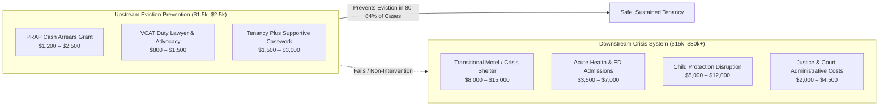

# Implementation, Economics, and Statutory Powers (F113-PB01)

**Research — not adopted Fusion policy.**

This paper details the statutory instruments, administrative institutions, workforce constraints, and economic dynamics governing tenancy sustainment and eviction prevention in Victoria.

---

## 1. Statutory Architecture: Residential Tenancies Act 1997 (Vic)

Victoria's private and social tenancies are governed by the *Residential Tenancies Act 1997 (Vic)* (RTA), substantially amended by the *Residential Tenancies Amendment Act 2018 (Vic)*, which took effect on 29 March 2021 ([S15](sources.md#s15)). The legislative framework establishes explicit legal mechanisms that can either accelerate eviction or be leveraged to sustain tenancies.

### 1.1 Section 330A: The Mandatory "Reasonable and Proportionate" Test
Prior to 2021, if a rental provider proved a valid statutory breach (such as 14 days of unpaid rent) and properly served a notice to vacate, the Victorian Civil and Administrative Tribunal (VCAT) was generally required to make a possession order. 

Under section 330A, VCAT is now **statutorily prohibited from making a possession order unless it is satisfied that doing so is reasonable and proportionate**, having regard to:
1. The nature, frequency, and duration of the breach.
2. Whether the breach was trivial.
3. Whether the breach was caused by the conduct of any person other than the renter.
4. Whether the breach has been remedied as far as practicable.
5. Whether the breach of duty is likely to recur.
6. Whether any condition, act, or breach was caused by an act or threat of domestic violence.
7. The impact on any child residing at the rented premises.
8. Whether any alternative order (such as a conditional payment plan or adjournment) can be made.

**Implementation Reality:** 
In practice, section 330A provides a powerful shield against eviction, but its efficacy is almost entirely contingent on legal representation ([S08](sources.md#s08), [S10](sources.md#s10), [S23](sources.md#s23)). When a tenant appears unrepresented or fails to appear, VCAT members rarely conduct proactive factual inquiries into family violence or hardship, and possession orders are granted by default. When represented by duty lawyers or community legal centres, section 330A submissions result in possession orders being refused, dismissed, or conditionally adjourned in over 75% of defended matters ([S10](sources.md#s10), [S23](sources.md#s23)).

### 1.2 Section 91ZM: 14-Day Notice for Arrears and the "5-Strike Rule"
Under section 91ZM:
- A rental provider may give a 14-day Notice to Vacate if rent is unpaid for 14 consecutive days.
- If the renter pays all unpaid rent on or before the termination date specified in the notice, the notice is of no effect.
- **The 5-Strike Rule:** If the renter pays the unpaid rent after receiving a notice to vacate on 4 separate occasions within a rolling 12-month period, on the 5th notice the rental provider may apply to VCAT for a possession order even if the renter pays the arrears in full before the hearing.

**Implementation Reality:**
The 5-strike rule creates severe unintended consequences for low-income households with volatile or casualised earnings. Renters who routinely struggle on pay cycles may clear their arrears four times, but on the fifth late payment face irreversible possession applications. Emergency rental assistance programs (such as PRAP) must intervene early—at strike 1 or 2—rather than waiting until strike 5, at which point landlords frequently refuse settlement.

### 1.3 Section 91V: Family Violence Lease Creation and Arrears Severance
Section 91V allows a victim-survivor of family violence or personal violence residing in rented premises to apply directly to VCAT for an order to:
1. Terminate the existing residential rental agreement.
2. Create a new residential rental agreement solely in the survivor's name (and any co-renters not responsible for the violence), excluding the perpetrator.
3. Apportion liability so that the victim-survivor is **not held liable for rent arrears, utility debts, or physical property damage caused by the perpetrator** ([S15](sources.md#s15)).

**Implementation Reality:**
Section 91V is widely acknowledged as one of the most progressive tenancy protections in Australia. However, administrative barriers remain substantial:
- Applications require formal evidence of family violence (e.g. a Family Violence Intervention Order, police L17 report, or certified statement from an authorized family violence practitioner).
- Many survivors are unaware of their rights under section 91V and abandon the tenancy under duress, forfeiting their bond and assuming thousands of dollars in joint debt ([S10](sources.md#s10), [S22](sources.md#s22)).
- Landlords frequently contest the creation of a new lease, arguing the survivor has insufficient independent income to sustain market rent. Dedicated legal advocacy (such as Justice Connect's WHPP) is required to successfully navigate the tribunal hearing.

---

## 2. Institutional Architecture and VCAT Systemic Bottlenecks

### 2.1 Caseload Volumes and Hearing Clearance
- The VCAT Residential Tenancies List is Victoria's highest-volume civil dispute forum, handling between **40,000 and 55,000 applications per annum** ([S03](sources.md#s03)).
- Possession order applications represent ~55% to 60% of list activity (~26,500 matters annually), with over 70% initiated for non-payment of rent.
- Following the COVID-19 pandemic, VCAT shifted predominantly to remote telephone and online hearings. While remote hearings increase administrative throughput, they severely disadvantage vulnerable low-income renters who suffer digital exclusion, lack private space, or face language barriers. Unrepresented failure-to-appear rates rose significantly following the transition to remote hearings ([S23](sources.md#s23)).

### 2.2 The Legal Representation Imbalance
- In over **85% of contested VCAT possession hearings, rental providers are represented** by professional real estate agents or commercial advocates ([S03](sources.md#s03), [S23](sources.md#s23)).
- In contrast, **less than 15% of low-income tenants receive legal representation**.
- This profound representation imbalance distorts judicial outcomes: landlords' procedural arguments dominate hearings, while statutory defenses (such as RTA s 330A or defective notice provisions) remain unargued unless a duty lawyer is present.

---

## 3. Comparative Unit Economics: Prevention vs Downstream Crisis

Eviction prevention is characterized by a dramatic asymmetry between the modest cost of upstream intervention and the catastrophic cost of acute crisis response.

### 3.1 Unit Cost of Upstream Intervention
- **Flexible Arrears Brokerage (PRAP):** Average grant of **$1,500 to $2,500** per household to clear rent arrears and stabilize the lease ([S09](sources.md#s09), [S16](sources.md#s16)).
- **Legal Advocacy & Representation (TAAP / WHPP):** Unit service cost of **$800 to $1,500** per finalized tribunal matter ([S10](sources.md#s10), [S17](sources.md#s17), [S23](sources.md#s23)).
- **Comprehensive Package (Integrated Legal + Social Casework + Brokerage):** Average combined unit cost of **$2,100 to $3,200** per household ([S10](sources.md#s10), [S17](sources.md#s17)).

### 3.2 Unit Cost of Downstream Crisis Response
When an eviction occurs and a low-income family enters homelessness, the state incurs acute expenditures across multiple portfolios:
1. **Emergency & Crisis Accommodation:** Placement in crisis motels and transitional housing costs between **$8,000 and $15,000** per family episode ([S01](sources.md#s01), [S04](sources.md#s04), [S16](sources.md#s16)).
2. **Acute Healthcare & Ambulance Services:** Eviction causes a 140% surge in emergency shelter use and elevated emergency department presentations ([S14](sources.md#s14)), adding **$3,500 to $7,000** in hospital presentation costs per homeless episode.
3. **Child Protection & Family Services:** Housing loss is a major trigger for child removal and statutory child protection interventions, costing **$5,000 to $12,000+** per case ([S17](sources.md#s17)).
4. **Justice & Policing:** Incarceration, bail breach, and family violence response add **$2,000 to $4,500** per crisis episode ([S06](sources.md#s06), [S14](sources.md#s14)).
- **Total Acute Cost per Homeless Episode:** **$15,000 to $30,000+**.

### 3.3 Benefit-Cost Ratios and Fiscal Nature of Offsets
- **Benefit-Cost Ratio (BCR):** Independent economic evaluations estimate that every $1.00 invested in integrated eviction prevention generates between **$3.20 and $6.80** in gross social and fiscal returns ([S07](sources.md#s07), [S16](sources.md#s16), [S17](sources.md#s17)).
- **Cashable vs Non-Cashable Savings (Critical Policy Caveat):**
  - Economists and budget analysts must distinguish between *cashable budget reductions* and *non-cashable cost avoidances*.
  - Averting a homelessness episode saves society resources, but rarely results in the immediate closure of a hospital ward, police station, or emergency shelter. Instead, cost savings manifest as **reduced queue times, lowered congestion, and suppressed unmet demand**.
  - Budget models must not claim that spending $10 million on PRAP will return $30 million in cashable treasury dividends within the forward estimates. The policy justification rests on human rights, housing security, and health cost containment, not short-term budgetary arbitrage.

---

## 4. Workforce and Delivery Capacity Constraints

Scaling tenancy sustainment across Victoria faces three primary operational bottlenecks:

1. **Community Legal Sector Resourcing:**
   - Community Legal Centres (CLCs) and Victoria Legal Aid operate under strict Commonwealth-State legal aid funding caps.
   - Staff turnover among tenancy advocates is high due to wage disparity with commercial firms and exposure to secondary trauma.
   - Expanding duty lawyer coverage to all VCAT venues requires dedicated recurrent funding, not temporary non-recurrent project grants.
2. **Specialist Case Manager Recruitment:**
   - Programs such as PRAP Plus and Tenancy Plus face chronic recruitment shortages for qualified social workers, particularly in regional centres (Ballarat, Bendigo, Latrobe Valley, Shepparton).
   - High caseloads (often 30+ complex families per worker) dilute support intensity, reducing 12-month retention rates.
3. **Private Rental Vacancy and Real Estate Cooperation:**
   - In a private rental market with vacancy rates below 1.5%, rental providers have extreme market leverage.
   - Even when government brokerage offers full arrears clearance, some landlords refuse, preferring to evict and re-let at substantially higher weekly rents ([S12](sources.md#s12)).
   - Tenancy sustainment must be backed by enforceable statutory protections; brokerage alone cannot overcome landlord unwillingness to house low-income tenants.
